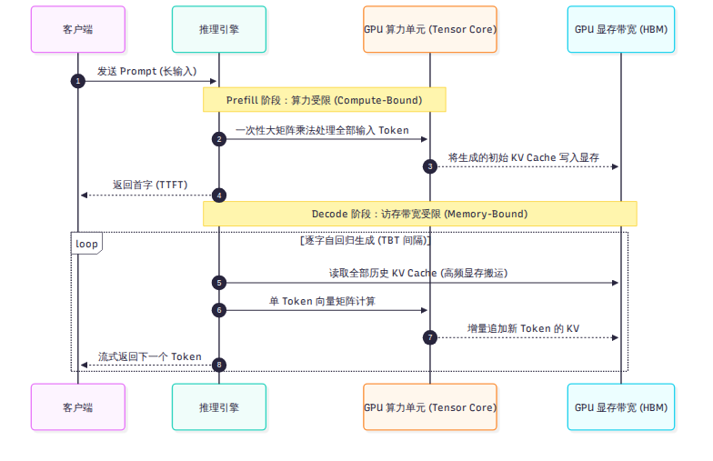
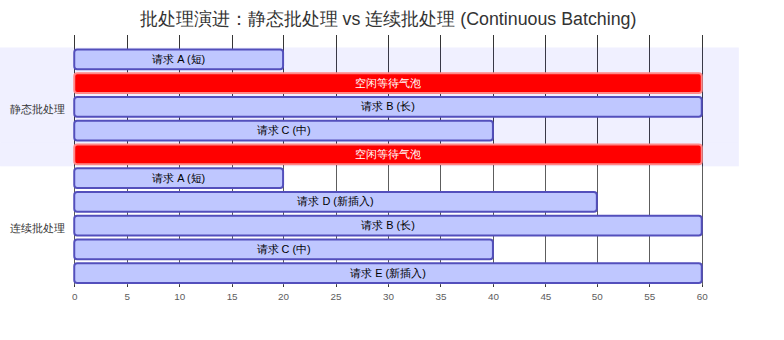

# 第 1 章 推理引擎在做什么

把一个大语言模型在本地单卡上用 Hugging Face 跑通，只需要十几行 Python 代码；但要把同一个模型部署到数据中心，支撑每天上百亿甚至上百万亿 token 的高并发访问，中间隔着一道巨大的系统工程鸿沟。本章是全书的技术底座：我们将拆解大模型推理在物理硬件上的真实瓶颈，建立 Prefill、Decode、KV Cache、连续批处理与专家并行的基础认知，为理解 DeepInfer 的特化设计做好准备。

---

## 1.1 大模型推理的两个阶段：Prefill 与 Decode

大模型在处理一次用户请求时，内部并非一成不变的计算，而是严格分为两个特征完全不同的阶段：**预填充（Prefill）阶段**与**解码（Decode）阶段**。

### 算力受限的 Prefill
当用户发送一段包含 2,000 个字的长提示词（Prompt）时，模型在第一个计算步需要将这 2,000 个 token 同时送入神经网络。此时，注意力机制中的 Query、Key、Value 矩阵乘法以及多层感知机（MLP）的运算，面对的是一个巨大的输入矩阵。

这种大矩阵乘法的计算密度（FLOPs per Byte）极高，现代 GPU 上的张量计算核心（Tensor Core）能够被充分打满。这个阶段的核心瓶颈是 GPU 的**浮点计算能力（Compute-Bound）**。用户从按下回车到屏幕上冒出第一个字所经历的等待时间，称为**首字延迟（Time to First Token，TTFT）**，它主要由 Prefill 阶段的计算速度决定。

### 带宽受限的 Decode
一旦 Prefill 结束，模型就进入了自回归（Autoregressive）生成阶段：每一步只能根据前文所有 token，预测并输出下一个单一 token。

在 Decode 阶段，输入矩阵退化成了单行向量。但为了计算这一个 token 与历史所有上下文的注意力关联，GPU 必须在每一个计算步，把模型的所有权重参数以及前文积累下来的全部历史中间键值状态，从显存（HBM）中完整搬运到片上缓存（SRAM）一次。

此时，计算单元在短短几十微秒内就完成了向量乘法，绝大部分时间都在干等显存总线把海量数据搬过来。这个阶段的核心瓶颈是 GPU 的**显存访问带宽（Memory-Bound）**。用户看到屏幕上的文字逐个蹦出的间隔时间，称为**字间延迟（Time Between Tokens，TBT）**。

将这两种物理瓶颈迥异的计算强行混在同一张 GPU 上运行，会导致 Prefill 的大算力冲击严重拖慢 Decode 的流式响应。这也正是现代顶级生产系统（如 DeepSeek 在第 4 章中展示的架构）坚决推行计算集群物理分离的根本原因。

---

## 1.2 显存黑洞：KV Cache 为什么决定成本

在自回归生成过程中，历史 token 的 Key 和 Value 向量如果在后续计算中反复全量重算，计算量将随序列长度呈二次方爆炸。为了避免重算，推理引擎会将每一步产生的历史 Key 和 Value 缓存在显存中，这就是 **KV Cache**。

### 显存线性膨胀与并发卡点
KV Cache 极大地节省了计算量，但代价是消耗了惊人的显存空间。以一个标准架构的大模型为例，单序列单 token 的 KV Cache 显存占用公式为：

$$  \text{KV Bytes per Token} = 2 \times n_{  \text{layers}}   \times n_{  \text{heads}}   \times d_{  \text{head}}   \times   \text{bytes\_per\_element}$$

在一个未经过度压缩的标准 70B 模型中，每个 token 的 KV 往往占用数千字节。当上下文长度达到 32K 或 128K 时，单条长连接请求所霸占的 KV Cache 显存就会高达几十吉字节（GB），甚至超过了模型权重本身的体积。

这就引出了一个残酷的工程现实：**决定一个推理节点能同时承载多少并发请求（Batch Size）的，往往不是 GPU 算力够不够，而是显存里的 KV Cache 会不会爆。** 显存一旦耗尽，系统就必须拒绝新请求或将正在生成的任务强行踢出。如何压缩 KV Cache 体积、如何在显存中高效存放它们，直接决定了推理系统的服务成本。

---

## 1.3 批处理与调度：Continuous Batching 的演进

为了摊薄模型的权重访存开销，推理引擎必须把多个用户的请求打包成一个批次（Batch）并发执行。

### 静态批处理的缺陷
在早期的深度学习服务中，系统采用静态批处理（Static Batching）：等待多个请求凑齐后一起启动。由于不同请求的输出长度差异巨大，有的请求生成 10 个 token 就结束了，而有的请求需要生成 500 个 token。短请求结束后，它所占用的显存槽位只能空转填充 Padding，直到批次中最长的请求跑完才能整体释放。这在 GPU 算力时间线上留下了大面积的空闲气泡。

### 连续批处理的引入
现代推理框架（以 Orca 和 vLLM 为代表）普遍引入了**连续批处理（Continuous Batching，或称迭代级调度）**。它的核心思想是打破请求间的强行捆绑，调度器以单步迭代为粒度进行管理：每走一步前向计算，一旦某个请求生成了结束标记（EOS），调度器立刻将其移出批次并释放资源，同时从等待队列中拉入新的 Prefill 或 Decode 请求填补空位。连续批处理彻底消除了静态批处理的尾部气泡，使 GPU 吞吐量获得了成倍的飞跃。

---

## 1.4 并行、投机与内核：压榨硬件的三把斧

面对千亿参数的大模型，单张显卡无论在算力还是显存上都已无法独立支撑，推理引擎演化出了三项核心技术支柱：

### 1. 分布式并行切分
- **张量并行（Tensor Parallelism，TP）**：将模型单层内的线性投影矩阵切分到多张卡上，卡间每步需执行高频 All-Reduce 通信，极度依赖机内高带宽 NVLink。
- **专家并行（Expert Parallelism，EP）**：专为混合专家模型（MoE）设计，将不同专家分布到不同卡上。每步根据门控路由，将 token 分发（Dispatch）到目标专家卡，算完再汇总（Combine）回来。

### 2. 投机解码（Speculative Decoding）
自回归 Decode 每步跑一遍大模型只吐出一个 token，显存带宽极度浪费。投机解码的核心思想是：用一个小巧轻量、耗时极短的“草稿模型”一口气猜测未来几个 token（例如猜 5 个），再让庞大精准的主模型在单步前向中同时验证这 5 个候选词。只要猜对了一部分，系统就能在单次大模型前向中产出多个 token，从而成倍缩短生成时间。

### 3. 底层高性能内核（Custom Kernels）
标准的 PyTorch 算子组合在底层会触发频繁的显存读写中间缓冲。通过使用 Triton、C++、CUDA 或新兴的 TileLang，工程师将多步计算（如注意力计算、激活函数、量化转换）直接融合到 GPU 内部片上 SRAM 中一次性完成（例如 FlashAttention、FlashMLA、DeepGEMM），从而将硬件执行效率推向物理极限。

---

## 小结

- 推理过程在物理上天然割裂为两段：算力受限的 Prefill（决定 TTFT）与访存带宽受限的 Decode（决定 TBT）。
- KV Cache 随着序列长度线性增长，其体积与管理效率直接卡死了推理系统的并发承载能力和单 token 边际服务成本。
- 现代推理系统依靠连续批处理、专家并行切分、投机解码以及手工汇编级融合内核，在吞吐量、延迟与硬件成本之间寻求动态平衡。

理解了这些通用规则后，我们便能看清：DeepInfer 究竟是如何在这个竞技场上，针对一个具体模型打出一套极其罕见的“特化组合拳”的。下一章，我们将正式揭开 DeepInfer 的神秘面纱。
