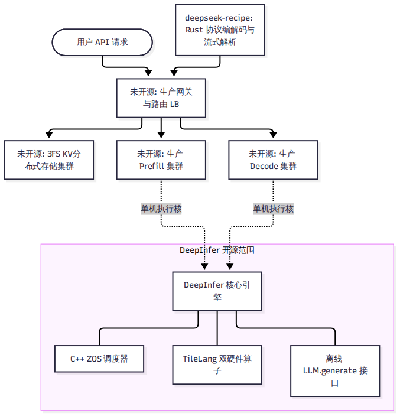

# 第 2 章 DeepInfer 是什么，不是什么

2026 年 10 月，DeepSeek 正式开源了其声称在生产环境中运行的核心推理引擎 DeepInfer。伴随开源发布，技术社区掀起了一阵热潮，甚至出现了“可直接替代 vLLM”、“一键搭建私有化 DeepSeek 满血服务”等广泛误读。本章的目标是拨开迷雾，用白纸黑字的代码和官方文档事实，准确厘清 DeepInfer 的开源边界、硬件门槛、真实定位以及它所解决的核心问题。

---

## 2.1 开源真相：发布背景与边界

在 GitHub 仓库 `deepseek-ai/DeepInfer`（基于初始提交 `d585e65` 至当前锁定版本 `9bd9cf2`）的根目录下，DeepSeek 采用了标准的开源协议（MIT License）。然而，开源一份代码并不等于开源了整个生产服务体系。

读者必须看清：**DeepInfer 只是 DeepSeek 线上推理庞大架构中的“单节点执行引擎”部分，而且仅仅提供了离线批处理推理接口。**

为了避免将未开源的功能误当成已有代码，我们将 DeepSeek 官方 Q&A 文档所披露的完整体系拆解为两个清晰的阵营：

| 分类 | 包含的组件与特性 | 开源状态 | 证据等级 |
| --- | --- | --- | --- |
| **开源包含的内容** | 离线推理主类 `LLM.generate`、C++ ZOS 异步调度器、基于 TileLang 的双硬件镜像算子、针对 V4.1-Flash 的模型前向实现、MTP 变长投机解码、批不变与确定性采样 | **已开源**（在当前仓库源码中） | A 级（代码证实） |
| **未开源的内容** | 外置分布式 3FS KV Cache 存储集群、VE/Prefill/Decode 跨节点物理分离编排调度、集群级四级动态负载均衡器、OpenAI 兼容在线 HTTP/gRPC 服务接口、分布式容错与健康检查 | **未开源**（仅在官方文档中有描述） | B 级（官方文档） |

换句话说，如果你克隆了 DeepInfer 仓库，你得到的是一台经过极端调校的“发动机核心”，而不是一辆挂上挡位就能直接载客上路的“整车”。代码中甚至没有包含任何基于 FastAPI 或 aiohttp 的在线监听端口，唯一的对外暴露接口是 `deepinfer.entrypoints.llm.LLM` 的离线生成函数。

---

## 2.2 苛刻的运行条件：单模型与双硬件

如果你尝试将 LLaMA-3、Qwen-2.5 或 Mistral 模型权重塞给 DeepInfer，或者试图在一台配备 NVIDIA A100、H100 乃至消费级 RTX 4090 的服务器上运行它，程序会在启动的第一秒毫不留情地崩溃报错。

### 1. 唯一支持的模型：DeepSeek-V4.1-Flash
DeepInfer 从设计之初就不是通用框架。它的调度逻辑、显存槽位、注意力掩码与并行通信，全部围绕 **DeepSeek-V4.1-Flash** 单一模型的数学结构展开。代码内部硬编码了该模型的注意力滑动窗口（128）、压缩比率分界（第 20 层）、专家数量（384+1）以及草稿验证块长。它放弃了对其他任何开源模型的兼容可能。

### 2. 唯一支持的硬件：NVIDIA SM100 与华为昇腾 950
在硬件加速器方面，DeepInfer 只面向两款顶级计算平台构建：
- **英伟达 Blackwell 架构（SM100，如 B200 / GB200）**
- **华为昇腾 Ascend 950 系列 NPU**

这一限制不仅体现在算子库的汇编实现中，甚至直接被写入了引擎初始化的断言门禁。在 `deepinfer/engine/llm_engine.py` 的初始化流程中，引擎调用 `get_bf16_tflops_limit()` 检测当前硬件算力峰值（分别对应 2250、2500 与 432 TFLOPS 档位）。如果在非 SM100 的英伟达显卡（例如 Hopper SM90 或 Ampere SM80）上运行，引擎会在构建统计记录器时直接抛出 `RuntimeError: unknown GPU type` 异常强行退出。

这种苛刻性正是其“专用引擎”特性的直接体现：为了追求极致性能，它在代码最底层直接调用了 Blackwell 的 TMA（张量内存加速器）与昇腾专有的统一缓冲区（UB）特性，彻底斩断了跨代通用兼容的妥协。

---

## 2.3 生产规模与官方动机

既然运行门槛如此严苛、功能如此特化，DeepSeek 为什么要在此时开源 DeepInfer？

### 官方动机的真实语境
在 2025 年 4 月关于推理基础设施的一份公开技术说明（open-infra-index）中，DeepSeek 曾客观评估其内部推理栈对于外部开发者而言“在没有重大改造的前提下进行公开部署是不切实际的（impractical for public deployment）”，因此当时选择优先向上游 vLLM 贡献底层组件。

这一表述在后来的部分二传报道中被过度解读为“DeepSeek 认为开源推理引擎不现实”。事实是，2026 年 10 月 20 日，DeepSeek 在其官方 X 平台（原 Twitter）发布正式公告，给出了开源该栈的官方动机原文：

> "We're sharing our production stack to help the community lower compute costs, reduce energy use, and make AI more affordable."
> （我们分享我们的生产技术栈，旨在帮助社区降低计算成本、减少能源消耗，并让 AI 变得更加普惠可及。）

### 官方公布的生产运营数字
在官方文档与知乎披露中，DeepSeek 给出了支撑其线上服务规模的关键运营指标：
- **日服务吞吐量**：每天处理并输出超过 **155 万亿（155 Trillion）token**。
- **单卡经济效益**：在公布的谷时定价模型折算下，实现了每 GPU 小时 **38 美元**的理论营收产出。

我们必须客观指出：这些数字带有极度严苛的前提条件——它建立在全系统 100% 打满、极高前缀缓存命中率、全球超节点互联以及谷时电价精细化调度的工业大集群之上，绝不能简单脱离上下文推导为普通小规模机房的常态收益。

---

## 2.4 配套利器：deepseek-recipe 协议解析器

在开源 DeepInfer 的同时，DeepSeek 在独立仓库中同步开源了 **`deepseek-recipe`**（Commit `935817c`，v0.2.0）。这是一个用 Rust 语言编写、并通过 PyO3 提供 Python 原生绑定的轻量级高性能前置库。

在真实的生产服务中，模型推理并不是直接接收纯文本：
1. **防止特殊 Token 注入攻击**：恶意用户可能在输入中伪造 `<|im_end|>` 或特殊的指令控制符，诱导模型发生逻辑越狱。`deepseek-recipe` 通过剥离词表中的敏感附加区间（added vocabulary），在分词阶段强制清洗，确保输入安全。
2. **多协议快速编解码**：支持 OpenAI 的 Messages、Chat Completions 以及 Anthropic 的 Responses 等多种上层协议，利用 Rust 的多线程并行能力，将长 Prompt 拆解分段并行编码，极大压低了 CPU 端的分词延迟。
3. **流式增量解析状态机**：在模型吐出 token 时，如何精准识别思考标记（如 `<think>` 与 `</think>`）并实时剥离？`deepseek-recipe` 内置了基于 KMP 算法的 11 状态流式状态机，以逐字节级别实时解析流式输出，确保客户端平滑获得干净的思考流与最终回复。

---

## 小结

- DeepInfer 是专为 DeepSeek-V4.1-Flash 量身定制的单机离线推理引擎，不是开箱即用的在线云服务。
- 它在硬件上严格绑定英伟达 SM100（Blackwell）与华为昇腾 950 两款顶级芯片，无法在通用显卡上直接运行。
- 分布式 KV 存储集群（3FS）、P/D 物理解耦与四级动态负载均衡器属于未开源的周边生态，配合开源的 deepseek-recipe 共同构成了完整的生产认知闭环。

在深入探究引擎如何运转之前，我们必须先彻底搞清楚它所服务的核心对象。下一章，我们将深入剖析 DeepSeek-V4.1-Flash 这个拥有 763B 参数的庞大模型究竟长什么样。
