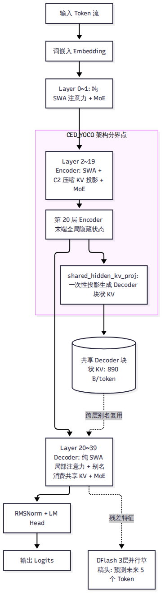

# 第 3 章 先认识它服务的模型：DeepSeek-V4.1-Flash

要理解 DeepInfer 为什么要把代码写成今天这副摸样，唯一的办法是先看懂它服务的对象。DeepInfer 的每一处显存管理、每一个算子分发、每一行调度逻辑，都是为了迁就 **DeepSeek-V4.1-Flash** 的数学与张量结构。如果脱离了这个模型，DeepInfer 的代码将失去绝大部分意义。本章将深入剖析 V4.1-Flash 的全局参数拓扑、多级注意力机制、CED 骨干分层、mHC 超连接以及 890 字节 KV 的精确来源。

---

## 3.1 总体拓扑：763B MoE 与 16.4B 激活

DeepSeek-V4.1-Flash 不是一个常规意义上的稠密（Dense）模型，而是一个超高稀疏度的混合专家模型（MoE）。

### 参数量实测求和
依据本地对 Hugging Face 发布的 48 个 `safetensors` 权重切片头部的逐 Tensor 遍历求和（A 级与 B 级证据，与 `safetensors.total = 763,205,315,794` 完全一致），模型的真实参数构成如下：

| 模块分类 | 参数量 | 存储精度与打包格式 | 占总参数比例 |
| --- | --- | --- | --- |
| **路由专家（Routed Experts）** | 543.6B | FP4（UE8M0 Scale，每 32 元素对齐打包） | 71.2% |
| **Engram 嵌入表（两层静态表）** | 196.9B | FP8（E4M3 格式） | 25.8% |
| **DFlash 草稿层（MTP 3 层）** | 14.2B | BF16 / FP8 混合 | 1.9% |
| **注意力投影（MLA 矩阵）** | 5.1B | BF16 | 0.7% |
| **共享专家（Shared Experts）** | 1.4B | BF16 | 0.2% |
| **词嵌入与输出头（Embed & LM Head）** | 1.32B | BF16（各 0.66B，词表大小 129,280） | 0.2% |
| **视觉编码器（ViT）与对齐投影** | 0.48B | BF16（ViT 0.41B + MLP 投影 0.073B） | <0.1% |
| **全局总参数（Total Parameters）** | **763.2B** | **全模型静态权重占用显存 510.3 GB** | **100%** |

### 激活参数与单层负载
尽管参数总量高达 7632 亿，但模型在处理任意单个 token 时，**激活参数量仅约为 16.4B**（包含词表计算；若剔除首尾 Embedding/LM Head，仅为 15.1B）。

全模型共包含 40 个隐藏层，所有 40 层皆为 MoE 结构，没有任何 Dense 前缀层。每一层包含 384 个路由专家与 1 个共享专家，每个 token 仅激活其中 6 个路由专家。单层激活参数仅为 377.3M（注意力 126.6M + 6 个路由专家 212.4M + 共享专家 35.4M）。这种高稀疏度意味着：系统必须在分布式切分中极度压低专家权重加载的访存代价，否则 763B 的总权重会彻底堵死显存总线。

---

## 3.2 注意力进化：MLA、稀疏 Indexer 与 890 字节 KV

在标准的 Multi-Head Attention（MHA）或 Grouped-Query Attention（GQA）中，上下文长度达到 1M token 时，KV Cache 的体积足以撑爆几台机器的显存。V4.1-Flash 采用了一整套复合的压缩与稀疏机制。

### 1. 多头潜在注意力（MLA）
模型使用 64 个 Query 头对准一条 512 维的共享潜在向量（Latent Vector），KV 头数仅为 1。在投影维度上，包含 448 维非旋转向量（Nope）与 64 维位置编码向量（RoPE），RoPE 仅打在末尾 64 维上。这种设计使 KV 的理论维度直接降低了一个数量级。

### 2. 稀疏索引器（Sparse Indexer）
在 `deepinfer/model_executor/models/v4_modules/index_attn.py` 中，模型配备了 32 头、每头 128 维的 Indexer 模块。在计算全量注意力前，Indexer 通过公式 $p_{  \text{sum}} = \sum w_h \cdot   \text{ReLU}(q \cdot k)$ 对历史 Token 进行粗筛。在第 20 层首先粗选出 2,048 个 8-token 块（共 16,384 token），后续 21–39 层在候选集合内精确挑选前 512 个 token 参与完整注意力计算。

### 3. 每 token 890 字节的数学推导
第三方常提到的“每 token 约 890 字节”并非估计值，而是可以在源码中严格复算的数学定值。

在 `deepinfer/worker/cache_engine.py:327-332` 中，块状 KV 的存储结构由两部分组成：
- **主注意力 KV（Main KV）**：采用 FP4 量化（E2M1 尾数 + E4M3 尺度，每 16 个元素共享一个 Scale），每压缩 token 占用 288 字节。
- **索引器 K（Indexer K）**：采用 MXFP4 量化（E2M1 尾数 + UE8M0 尺度，每 32 个元素共享一个 Scale），每压缩 token 占用 68 字节。

更关键的是：**块状 KV 并不是由全部 40 层分别生成的，全模型只有 4 个源层会产生块状 KV！**
根据 `deepinfer/hugging_face/config.py` 中的 `kv_source_layer_ids = [2, 8, 14, 20]`：
- 第 2、8、14 层为 C2 压缩层（压缩比 ratio = 2，相邻 2 个 token 做加权平均生成 1 个压缩 token）。
- 第 20 层为 C1 压缩层（压缩比 ratio = 1，保持恒等）。

因此，单序列平均到每个输入 token 上的块状 KV 体积精确为：

$$  \text{KV Bytes} = 3 \times \frac{288 + 68}{2} + 1 \times (288 + 68) = 3 \times 178 + 356 = 534 + 356 = 890 \text{ 字节/token}$$

在 1M 上下文下，单请求的块状 KV 仅需 890 MiB 显存，这彻底扫清了长上下文在跨节点传输与持久化存储上的容量障碍。

### 4. 全量 40 层 SWA 局部注意力
除了块状 KV，模型还在所有 40 层全部采用了滑动窗口注意力（Sliding Window Attention，SWA），窗口长度固定为 128。在 `cache_engine.py` 中，SWA KV 采用 MXFP8 格式（528 字节/token/层）。

一个极其重要的代码事实是：**V4.1-Flash 全模型没有任何一层全量注意力层！** 在 `attn.py` 中，`_is_full` 恒等于 `False`。如果调度器试图对某一层请求 Full Attention，`KVCacheManager` 会直接抛出异常。全模型在宏观上依赖前 20 层的隐状态传递与后 20 层的局部 SWA 注意力相配合。

---

## 3.3 骨干拓扑：CED 分层与 YOCO 跨层复用

在代码中，V4.1-Flash 的 40 个层被赋予了独特的角色划分，这在内部被称为 CED（Compress-Encoder-Decoder）或 YOCO 结构。

### 20 + 20 层的结构界限
通过检查 `deepinfer/hugging_face/config.py:158-161`，分界并不是一个独立的配置字段，而是从压缩比列表 `compress_ratios` 中推导得出的：
- **前 20 层（Layer 0~19，Encoder 侧）**：Layer 0~1 为纯 SWA 局部层，Layer 2~19 包含 C2 压缩注意力。
- **后 20 层（Layer 20~39，Decoder 侧）**：压缩比全为 1。

需要特别说明的是，在代码实现中，Encoder 与 Decoder **并不是两个不同的 Python 类**。全模型 40 层由同一个 `DeepseekDecoderLayer` 统一驱动，仅仅通过传入的层号与拓扑配置表现出不同的计算行为。

### 第 20 层的跨层投影
YOCO 架构最精妙的工程设计在于：**后 20 层的块状 KV 并不是逐层计算出来的，而是直接继承自第 20 层！**

在 `deepinfer/model_executor/models/v4_modules/attn.py:345-353` 中，第 20 层的注意力权重矩阵包含一个特殊的独立投影算子 `shared_hidden_kv_proj`。当输入张量经过前 20 层 Encoder 计算、到达第 20 层入口时，其末端隐藏状态直接被该算子投影出一份全量块状 KV。后续第 21 到 39 层在模型前向时，根本不持有独立的 KV 投影权重，而是通过 `cache_engine.py` 中的 `layer_kv_map` 直接以别名方式共享这份 KV。

这一机制是第 8 章“SWA 有界重放能够让 Prefill 计算量减半”的核心前提：既然 Decoder 层的块状 KV 在第 20 层就已经由全局隐藏状态一次性搞定了，后 20 层在 Prefill 阶段自然就没有必要再对历史前文做昂贵的全量前向计算。

---

## 3.4 前沿模块：mHC 超连接与 Engram 嵌入增强

除了主干注意力与专家网络，V4.1-Flash 还嵌入了两项特殊的先锋结构：

### 1. mHC（Hyper-Connections，超连接）
在 `v4_modules/hc.py` 与 `mhc_ops.py` 中，传统的单通道残差流被扩展为包含 4 个子流的四维通道（张量形状为 `[batch, 4, 5120]`）。在每一个 Transformer 子层前后，模型通过 24×20480 的单精度（fp32）GEMM 矩阵与 20 次 Sinkhorn 归一化迭代，将 4 个残差子流进行充分混洗。

这种设计大幅提升了深度网络的梯度流转能力，但在推理工程上也带来了沉重代价：它打破了现代推理引擎普遍依赖的标准“残差相加与 RMSNorm 融合算子”（Fused Add-RMSNorm），使得引擎必须为 mHC 手写专用的片上混洗 Kernel。

### 2. Engram 静态 N-gram 嵌入表
在 `v4_modules/engram.py` 中，模型在第 1 层和第 14 层分别挂载了巨大的静态 N-gram 查找表。Engram 拥有 3 张独立的 N-gram 表，采用 8 个头部与多哈希桶设计，总参数量高达 196.9B（占全模型权重的 25.8%），在 FP8 格式下单层表体积即达 786 GB。

Engram 的作用是绕过注意力计算，直接通过静态多 Token 哈希查找提取局部的固定词组搭配语义。但它在 Decode 阶段带来了一个棘手问题：当 ZOS 异步调度开启时，N-gram 的滑动查找窗口横跨了 CPU 刚提交的未解压数据与 GPU 显存中的环形缓冲区，这逼迫 DeepInfer 必须为其编写专用的 `gather_engram_tokens_zos` 算子来跨存储收集上下文。

---

## 3.5 草稿生成与视觉编码器

### DFlash 草稿模块
投机解码所需要的草稿 Token 由内置的 DFlash 模块生成（定义于 `models/mtp/dflash.py`）。它由挂载在主干顶部的 3 个独立草稿层（层号 40、41、42）组成，参数量为 14.2B。

DFlash 的核心特点是：它并不是自回归地串行猜测 5 次，而是对未来 5 个位置的输入块执行一次性、非因果的并行前向。在第 42 层末端，模型设计了专门的置信度头 `ConfidenceHead`（`mtp.2.confidence_head.proj.weight`，形状为 `[1, 5376]`），用于预测每个草稿 token 能够被主模型接纳的概率，为第 10 章的 DSpark 变长验证提供了决策输入。

### 视觉编码器（Vision Encoder）
多模态支持由 32 层、1024 隐藏维度的视觉 Transformer（ViT）提供，参数量为 411.9M。图像通过 Patch 大小为 14 的卷积切块编码后，送入下采样投影层 `downsample_mlp_gelu`（包含 73.41M 参数，定义于 `vl_aligner.py:69-76`），将 9216 维的展开特征压缩映射为 5120 维的主模型向量，在 Prefill 阶段直接替换序列中的 `<image>` 占位 Token。

---

## 全书核心索引：模型特点与引擎设计对照

下表是全书最重要的技术逻辑锚点。后文所有章节探讨的引擎机制，均可在此找到其最初的物理源头：

| 模型结构特性（第 3 章） | 带来的物理/系统挑战 | DeepInfer 推理引擎的设计对策 | 对应详解章节 |
| --- | --- | --- | --- |
| **763B 超大总参数 / 16.4B 激活** | 权重过大，单卡装不下；Decode 显存带宽受限 | 放弃 TP，全面推行宽专家并行（Wide-EP，EP64–128），每卡仅存少量专家 | 第 4、9 章 |
| **890 字节/token 极限压缩 KV** | 显存容量急剧释放，单卡可承载上下文暴增 | 采用 128 对齐 uint8 紧凑字节带与 FP4/MXFP4 低精度量化；支持外置持久化 | 第 7、13 章 |
| **全 40 层皆为 128 窗口 SWA** | 无全局自注意力，长历史状态难以依靠历史滑动维持 | 提出 128 token 有界重放（Bounded Replay），以常数算力近似局部注意力 | 第 8 章 |
| **YOCO 架构与第 20 层 KV 投影** | Decoder 层不自产块状 KV，Prefill 算力大量浪费 | Decoder 彻底放弃历史 Prefill 前向，算力直接降低 98.6% | 第 8 章 |
| **DFlash 3 层并行草稿与置信度头** | 固定验证 5 个 token 在生产大并发下造成算力浪费 | DSpark 变长验证算法：利用置信度头动态裁剪最优验证长度 | 第 10 章 |
| **mHC 四流超连接与 Engram 表** | 打破常规 Fused RMSNorm 算子；查找跨越 CPU/GPU | 编写专用 TileLang 算子；编写 `gather_engram_tokens_zos` 数据对齐算子 | 第 5、11 章 |
| **双硬件落地（SM100 与 昇腾 950）** | 微架构迥异（TMA vs Unified Buffer） | 依托 TileLang 统一抽象，分设 `cuda/` 与 `asc/` 30 对镜像算子 | 第 11 章 |

---

## 小结

- DeepSeek-V4.1-Flash 是一个 763B 总参数、16.4B 激活、全 40 层 MoE + SWA 的高稀疏度混合精度模型。
- 通过 MLA、稀疏 Indexer 与 4 个源层的时空压缩，模型将块状 KV 压到了每 token 890 字节的极致密度。
- 架构呈现清晰的 20 层 Encoder 与 20 层 Decoder（YOCO）划分，第 20 层一次性投影出全量块状 KV，为引擎彻底甩掉 Decoder 侧的 Prefill 算力包袱创造了数学前提。

了解了这只“吞吐巨兽”的内部骨骼，我们现在将视野拉升到整个数据中心。下一章，我们将俯瞰 DeepSeek 为其构筑的超大规模生产系统全貌。
