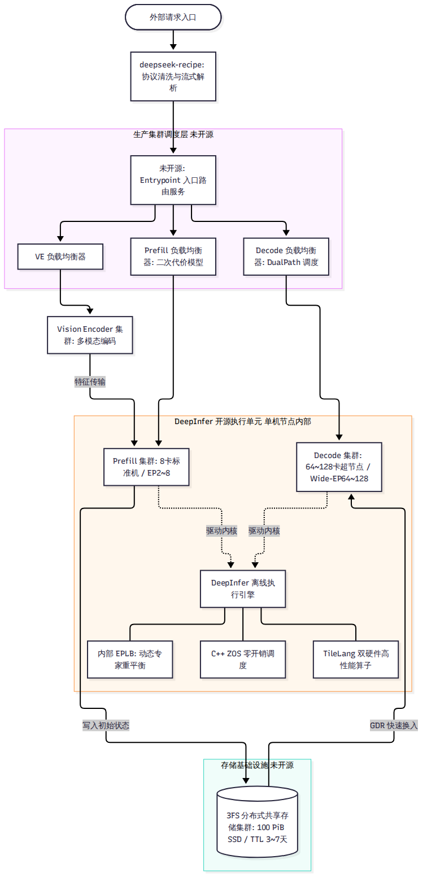
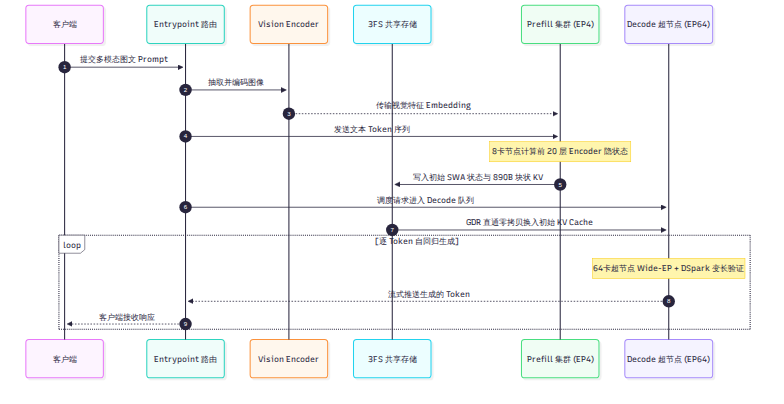

# 第 4 章 DeepSeek 推理系统的全貌

::: warning
本章内容综合自 DeepSeek 官方技术文档（`doc/inference_deployment_qa.md`）与官方知乎文章披露。相关的大规模分布式集群调度、3FS 外置存储与网络负载均衡器**并未包含在开源的 DeepInfer 代码库中**。全书始终区分“代码里有的”与“文档里描述的”。
:::

单机执行引擎再快，如果脱离了合理的集群部署形态，面对每天 155 万亿 token 的流量洪峰依然会瞬间窒息。本章是全书的全景鸟瞰篇：我们将走出单机视角，俯瞰 DeepSeek 完整生产系统的物理拓扑，剖析其为什么坚决推行 VE/Prefill/Decode 三段解耦、为什么彻底抛弃张量并行（TP）而押注宽专家并行（Wide-EP），并勾勒出开源的 DeepInfer 究竟镶嵌在这个庞大版图的哪一个齿轮之上。

---

## 4.1 系统的三个设计目标与取舍

根据官方部署问答的披露，DeepSeek 在为其生产推理体系定型时，确立了三个毫不动摇的物理设计目标：

1. **兼容多厂商芯片架构（Multi-Vendor Hardware Support）**：系统不能被单一闭源算力生态所绑架。底层必须能够在英伟达与国产算力（华为昇腾）之间灵活平替，且在两套芯片上都必须榨出最高效能。
2. **P/D 物理分离与硬件异构配置**：Prefill 阶段算力密度极高，采用普通 8 卡标准服务器（如 8×SM100 或 8×昇腾 950）以较小的专家并行度（EP2–8）独立承接；Decode 阶段显存带宽极度紧缺，采用 64–128 张卡组成的巨型超节点（Super-Node），推行超宽专家并行（EP64–128）全力摊薄访存。
3. **KV Cache 超长跨请求留存（Ultra-Long KV Retention）**：基于自研的 3FS 分布式存储集群，将高价值的上下文前缀缓存全量保存在外置 SSD 存储池中，保留周期长达 3 至 7 天，使跨会话前缀命中率逼近极限。

这三个目标每一个都对传统单体推理引擎发起了挑战：它彻底打破了“单台服务器既跑 Prefill 又跑 Decode、显存私有、卡内闭环”的传统认知。

---

## 4.2 架构解耦：VE、Prefill 与 Decode 三段分离

为了践行上述目标，DeepSeek 在生产环境中将单次推理请求拆解为物理上完全独立的三个阶段服务池：

### 1. 视觉编码服务（Vision Encoder Service，VE）
负责处理多模态图像与视频输入。由于视觉 Transformer（ViT）的特征提取属于典型的稠密计算且不依赖文本历史 KV Cache，VE 被剥离为独立的服务池。图片在入口处被统一转化为高维嵌入向量（Embedding），随后直接通过网络移交给 Prefill 节点，不再占用主语言模型的宝贵显存。

### 2. 预填充计算服务（Prefill Service）
专职处理文本与图像的首次大批量上下文编码。Prefill 节点配置为 8 卡小规模并行，主要瓶颈是张量乘法算力。Prefill 节点在完成前 20 层 Encoder 计算后，将生成的初始状态与 890 字节块状 KV 异步推入外置 3FS 存储集群，自身即可立即释放显存，转去抢攻下一个长 Prompt。

### 3. 解码生成服务（Decode Service）
专职负责流式输出。Decode 节点配置为 64 至 128 卡超节点，各卡通过高速无阻塞网络组成极宽的专家并行域。Decode 节点直接从 3FS 存储中将请求的初始状态快速换入显存，随后在多卡协同下以极高的 token/s 吞吐流式生成回复。

---

## 4.3 并行切分决策：为什么不用 TP，偏爱 Wide-EP

在大模型分布式推理中，业界通用的标准做法通常是“机内 8 卡做张量并行（TP8），机间再做数据并行或流水线并行”。然而，DeepSeek 的生产规范中赫然写着：**生产环境不使用张量并行（TP）与上下文并行（CP）。**

### 为什么坚决弃用张量并行？
张量并行将矩阵切开，每一个注意力层与每一个 MLP 层的前后，都必须在所有卡之间执行一次阻塞式的 `All-Reduce` 集合通信。
- 在 64–128 卡的超大规模集群中，跨节点执行高频 `All-Reduce` 会引发严重的网络拥塞与微秒级时钟等待。
- 更致命的是，在 Decode 阶段，瓶颈根本不是计算不足，而是**每一卡都需要把分配给自己的模型权重从显存搬进计算单元**。TP 并不能减少单步总共需要加载的专家权重总数。

### 为什么押注宽专家并行（Wide-EP）？
V4.1-Flash 拥有 384 个路由专家。如果只用 8 卡并行（EP8），平均每张卡必须分担 48 到 52 个专家的静态权重（包含冗余），每走一个解码步，GPU 都必须在显存里把这 52 个专家的庞大矩阵搬运一遍。

而一旦将并行度扩大到 64 卡（EP64）：
- **每张卡平均仅需托管 6 到 7 个专家**！单步的专家权重加载流量直接缩减为 EP8 的 $\frac{1}{7.43}$。
- 虽然卡数增多导致 All-to-All 通信的连接数呈平方级增长，但得益于 DeepEP 的高吞吐非阻塞通信与 NVLink 全互联拓扑，通信耗时被极其高效地隐藏在计算之后。

根据官方 Q&A 披露的数据，在相同的并发负载下，从 EP8 提升到 EP64，虽然跨卡通信步数增加，但得益于显存搬运量的暴降，单卡推理吞吐量仍获得了 5% 到 53% 的显著净提升。

---

## 4.4 生产数据流走读：一个请求的集群旅程

为了让读者形成全局时序概念，我们跟踪一个携带长文本和图片的实际生产请求，观察它在整个集群系统中的物理流转过程：

1. **协议接入与清洗**：客户端发起请求，首站进入 API 网关。网关调用 `deepseek-recipe`，在几毫秒内完成特殊控制符过滤、协议标准化转换，并将长输入切块分段。
2. **多模态前置处理**：请求中的图像部分被路由至 VE 服务集群。VE 独立前向运行 ViT 骨干网络，将图像转化为特征张量并回传。
3. **Prefill 配额调度**：Prefill 负载均衡器基于二次代价模型评估该请求的算力开销，将其分配给负载最轻的 8 卡 Prefill 节点。Prefill 节点执行输入编码，计算出前 20 层 Encoder 状态与块状 KV。
4. **异步持久化落盘**：Prefill 节点将计算好的 890 字节 KV 块与 SWA 初始状态，通过高速网络异步写入 3FS 存储集群。Prefill 任务宣告完成，节点立即处理新任务。
5. **Decode 动态认领**：Decode 负载均衡器从等待池中认领该请求，并指派给一个 64 卡 Decode 超节点。
6. **GPUDirect 显存直通换入**：Decode 超节点直接通过 GPUDirect RDMA（GDR）技术，以超过 10 TiB/s 的聚合读带宽，直接将该请求在 3FS 中的前缀状态无拷贝写入 GPU HBM 显存。
7. **多卡协同流式生成**：进入自回归循环。注意力部分在每张卡内部独立运行，MoE 专家部分通过 DeepEP 跨卡高速分发，结合 DSpark 动态验证裁剪，将生成的 token 逐个流式回传网关直至结束。

### 开源 DeepInfer 的真实坐标
看完了这一气呵成的工业级流水线，读者便能深刻理解：**开源仓库 `deepinfer` 对应的是上述流程第 3 步和第 7 步中，在 Prefill 机器和 Decode 机器单节点内部驱动物理 GPU 运行的那个执行核心。** 

至于如何发现节点、如何拉取 3FS、如何跨机路由，全部属于包围在 DeepInfer 外围的未开源工业级系统框架。

---

## 小结

- DeepSeek 生产系统的灵魂在于解耦：支持双硬件底座、P/D 物理集群分离，以及基于 3FS 的长周期前缀存储。
- Decode 阶段彻底放弃张量并行（TP），全面拥抱 Wide-EP（EP64–128），通过将每卡专家数压缩至 6–7 个，从根本上击穿了显存带宽瓶颈。
- 完整请求经历“网关清洗 → VE 编码 → 8 卡 Prefill → 3FS 换入 → 64 卡 Decode”五站式流转，开源的 DeepInfer 是承载单节点前向计算的动力引擎。

既然 DeepInfer 是单节点上的核心发动机，我们现在就把镜头拉近到它的代码实现。下一章，我们将打开仓库源码，从第一行代码开始，绘制出它的内部软件地图。
