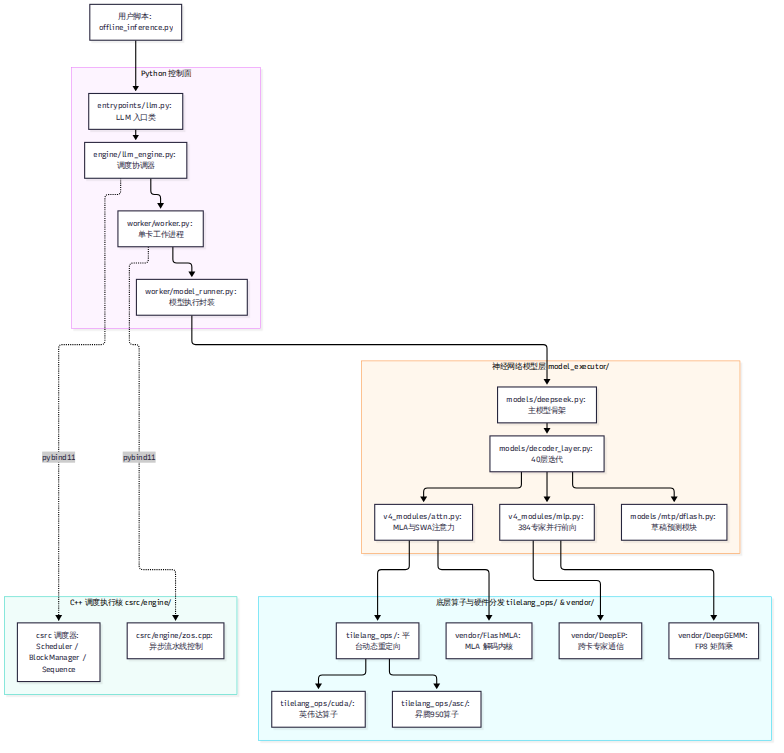
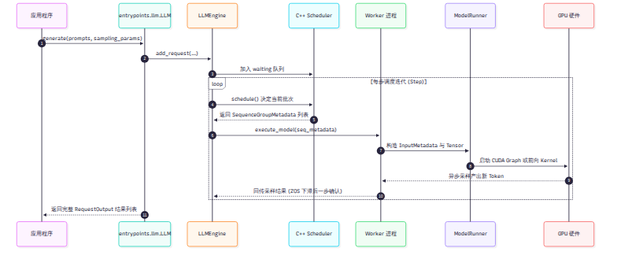

# 第 5 章 代码地图：仓库结构与一个请求的一生

对于第一次打开 `deepinfer-ai/DeepInfer` 仓库的开发者来说，扑面而来的近 6 万行 Python 代码、数千行 C++ 内核、复杂的共享内存通信以及 6 个 vendor 子模块往往让人无从下手。本章将充当读者的代码导游：我们将逐层剖析仓库的目录职责划分，还原多 GPU 环境下的 Worker 进程模型，并沿着一次实际的 `LLM.generate()` 调用，步步追踪一个请求在代码各层之间的流转轨迹。

---

## 5.1 仓库全景目录与模块分工

依据对当前锁定 commit（`9bd9cf2`）的精确统计，DeepInfer 呈现出清晰的“三层两翼”工程布局：

### 1. 顶层目录结构与职责划分

| 顶层目录 | 代码规模与主力语言 | 核心职责与工程定位 |
| --- | --- | --- |
| `deepinfer/` | 222 文件，47,172 行 Python | 引擎主体控制面，涵盖入口、调度协调、工作进程、模型执行层与 TileLang 算子分发。 |
| `csrc/` | 18 文件，5,909 行 C++（纯 Host 侧） | 引擎核心性能中枢。负责毫秒级调度器（Scheduler）、显存块管理器（BlockManager）与 ZOS 异步状态控制。 |
| `vendor/` | 6 个 Git 子模块，纯自研部分约 6.4 万行 | 底层高性能通信与计算算子库：`DeepEP`（通信）、`DeepGEMM`（矩阵乘）、`FlashMLA`（注意力）、`DeepSelect`（稀疏选择）。 |
| `deep_cluster/` | 6 文件，1,200 行 Python/Bash | 硬件基础设施拓扑绑定工具，负责 NUMA、CPU Core、NIC 与 GPU 之间的亲和性绑定。 |
| `examples/` | 14 文件，2,400 行 Python | 离线推理示例（`offline_inference.py`）、基准压测（`benchmark.py`）与等价性验证脚本。 |
| `tests/` | 38 文件，4,800 行 Python | 单元测试套件，重点覆盖算子对齐、批不变、KL 散度与状态缓存操作。 |
| `eval/` | 12 文件，1,600 行 Python | 正确性评估套件，包含 AIME、GPQA、HLE 等严苛学术评测流水线。 |

### 2. 调度器 C++ 化：与 vLLM 的关键结构差异
在主流的 vLLM V0 架构中，调度器（Scheduler）通常是用纯 Python 实现的。但在 DeepInfer 中，`csrc/engine/` 下的 `scheduler.hpp`、`block_manager.hpp` 和 `sequence.hpp` 承担了全部的调度与资源分配，并通过 `csrc/engine/pybind_scheduler.cpp` 编译为 `deepinfer._C.engine` 导出给 Python 调用。

将调度器下沉到 C++ 带来了三条决定性的收益：
- **释放全局解释器锁（`gil_scoped_release`）**：在调度计算、序列状态构建与块锁定期间彻底摆脱 Python GIL 锁竞争。
- **高频对象池复用**：`SequenceMetadata` 与 `RequestOutput` 结构体直接在 C++ 对象池中轮转，消除了 Python 垃圾回收（GC）的停顿抖动。
- **零拷贝返回**：C++ 调度结果直接借用静态向量（Static Vector）以零拷贝 NumPy 数组的形式返回给 Python，极大地压低了每步调度的 CPU 耗时。

---

## 5.2 进程模型与共享内存广播

当我们在命令行以 8 卡配置启动 DeepInfer（例如 `--ep 8`）时，系统是如何在物理上组织多进程协作的？

### 1. 严格的单卡单 Worker 进程模型
在 `deepinfer/engine/llm_engine.py:378-402` 中，全局世界大小（World Size）由公式严格决定：

$$  \text{world\_size} =   \text{dp\_size}   \times   \text{cp\_size}$$

在纯 DP+EP 模式下，系统为每一张物理 GPU 启动且仅启动一个 `Worker` 进程。全局包含一个特殊的进程内主控者（Driver Worker，位于主进程），以及 $N-1$ 个通过 Python `spawn` 创建的从属工作进程（Follower Workers）。

### 2. 无名共享内存环（SHM MessageQueue）
在多 GPU 环境下，如果使用常规的 PyTorch RPC 或 TCP 套接字分发调度指令，序列化与网络协议栈的延迟将吞噬异步调度的收益。

DeepInfer 在 `deepinfer/distributed/shm_broadcast.py` 中实现了一套极其轻量高效的控制通道：
- **无名共享内存环**：Driver 与所有 Follower 之间通过一段预先映射的共享内存（1 MiB 循环缓冲区）进行通信。
- **无返回值单向广播**：Driver 每次发布指令时，直接将调用的方法名与参数元组 `(method, kwargs)` 写入该内存环，所有 Worker 通过无锁自旋或条件变量毫秒级唤醒。
- **张量走 NCCL，控制走 SHM**：复杂的 `seq_metadata_list` 并不通过慢速的 Python 序列化广播，而是通过 `broadcast_tensor_dict`（张量数据走机内 NCCL 广播，轻量元数据走共享内存），Worker 在本地直接重构 `InputMetadata`。

---

## 5.3 追踪一次 generate：从入口到返回

为了建立直观的执行感知，我们顺着代码调用栈，逐步追踪一次 `LLM.generate()` 的生命周期：

### 阶段一：请求提交与入队
1. **用户入口（`entrypoints/llm.py:generate`）**：用户传入提示词文本和采样参数 `SamplingParams`。`LLM` 实例对输入进行初步分词校验，随后调用引擎的 `add_request`。
2. **状态初始化（`engine/llm_engine.py:add_request`）**：引擎在 C++ 层面分配唯一的 `request_id`，为该请求建立 `Sequence` 结构体，并将其挂入 C++ 调度器的 `waiting` 等待队列。

### 阶段二：迭代步驱动（Step Loop）
引擎主循环进入连续批处理迭代，不断调用 `llm_engine.step()`：
1. **调度裁决（`csrc/engine/scheduler.hpp:schedule`）**：C++ 调度器被调用。它根据当前显存块的空闲情况，决定从 `waiting` 队列拉入新请求执行 Prefill，或是从 `running` 队列挑选已有请求执行 Decode。输出被打包为 `SequenceGroupMetadata`。
2. **工作进程派发（`worker/worker.py:execute_model`）**：Driver 通过共享内存环唤醒所有 Worker，将调度元数据下发。
3. **输入张量装配（`worker/model_runner.py:prepare_input_tensors`）**：各卡读取本地分配到的 Token，调用 `prepare_tensor_input_zos` 算子组装注意力掩码、位置编码与槽位映射表。
4. **模型前向（`models/deepseek.py:DeepseekModel.forward`）**：张量进入神经网络。前 20 层执行 MLA 与压缩注意力计算；在第 20 层末端，`shared_hidden_kv_proj` 投影出 Decoder 块状 KV；后 20 层执行局部 SWA 注意力；MoE 层通过 DeepEP 将 Token 路由至目标卡上的专家网络。
5. **采样与预测（`layers/sampler.py:Sampler`）**：采样器仅在 Driver 端执行。GPU 计算出全词表 Logits，结合温度（Temperature）和 Top-P 规则采样出新 Token。如果是投机模式，DFlash 还会额外生成未来 5 个位置的草稿 Token。

### 阶段三：输出回收与结束
采样的 Token 编号被返回给引擎。在 ZOS 模式下，后处理逻辑被延后到下一步异步执行。当检测到序列生成了 `<｜end of sentence｜>` 终止符或达到最大长度时，C++ `BlockManager` 释放其占用的显存块，请求被移入 `finished` 状态，最终解包为字符串或 `RequestOutput` 结构体交付给用户。

---

## 5.4 性能护甲：CUDA Graph 与硬件拓扑绑定

在 Decode 阶段，单步模型前向的计算时间极短（通常在 1.5–3.0 毫秒之间）。如果每一步都由 Python 动态下发几十个 Kernel，Kernel Launch 的驱动开销就会反客为主。

### 1. 档位化 CUDA Graph 覆盖
DeepInfer 在 `deepinfer/worker/cuda_graph_runner.py` 与 `dflash_cuda_graph_runner.py` 中实现了对 Decode 全流程的静态图录制：
- **按 Token 总数分档**：系统并不按请求数录制图，而是以总处理 Token 数（`total_q = batch_size × (1 + nextn)`）为档位进行等距切分。
- **主模型与草稿图解耦**：主模型的 Decode 前向被录制为一张主图，DFlash 的草稿生成被录制为副图。副图显式复用主图的显存内存池（Memory Pool）与 CUDA 流，彻底消除了显存碎片。

### 2. 硬件拓扑亲和性绑定（`deep_cluster/`）
在拥有多个 CPU Socket、多块 NUMA 内存节点和多块高速网卡的超节点服务器上，跨 NUMA 内存访问会导致总线带宽腰斩。

在引擎启动前，`deep_cluster/topology/bind.py` 会扫描系统的 PCI 拓扑树：
- 将每一个 GPU Worker 进程精确绑定到其物理直连的 CPU Core 核心集合上。
- 将网络通信线程强行锁定在物理距离最近的网卡中断（IRQ）对应的 NUMA 节点上。

这种“软硬件咬死”的拓扑控制，确保了系统在大规模分布式高频通信时，不会因为操作系统的线程随机调度而发生偶发性的毫秒级网络抖动。

---

## 小结

- DeepInfer 在架构上严格解耦为 Python 控制面、C++ 调度执行核与底层 TileLang 算子库，C++ 调度器从根本上消除了 Python GIL 瓶颈。
- 采用单卡单进程 Worker 模型，进程间依靠 1 MiB 循环共享内存无锁广播控制指令，确保了控制面的极低延迟。
- Decode 阶段由按 Token 档位录制的 CUDA Graph 全量接管，并辅以 `deep_cluster` 的硬件亲和性强绑定，筑牢了微秒级响应的性能防线。

至此，我们已经掌握了引擎的代码脉络。在接下来的第三部分中，我们将正式攻坚 DeepInfer 的核心技术战壕。首当其冲的，便是解决 GPU 空闲气泡的调度艺术。
