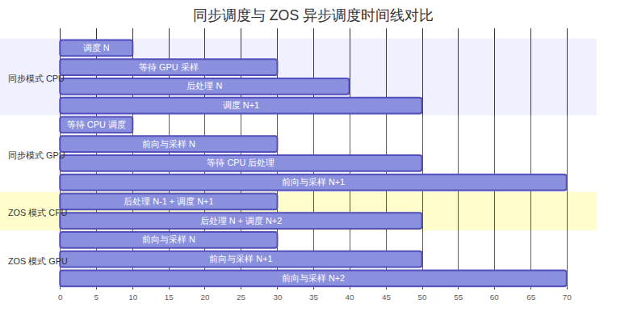
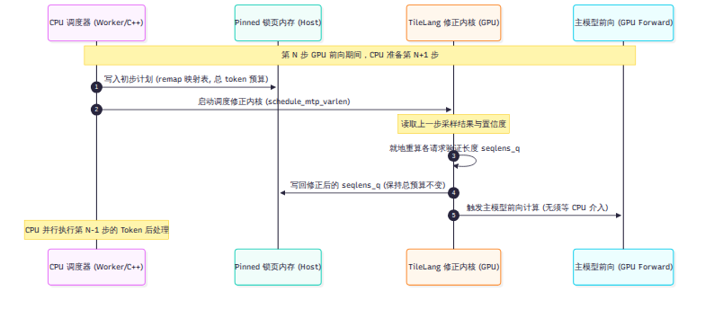

# 第 6 章 调度：让 GPU 一刻不停

推理引擎的调度器负责决定每一轮计算放哪些请求、每个请求算几个 token。如果调度器设计不当，GPU 就会频繁停下来等待 CPU 指令。本章探讨 DeepInfer 如何消除调度气泡：它使用零开销异步调度（ZOS）让 CPU 提前一步排定任务，并在 GPU 端就地修正投机解码长度；同时澄清开源版本在 Prefill 分块上与官方部署文档的差异。

---

## 6.1 同步调度的软肋：GPU 气泡

在传统的同步调度模型中，解码（Decode）的每一个计算步（step）按严格的先后顺序执行四项操作：

1. **调度（Schedule）**：CPU 遍历等待队列与运行队列，决定哪些请求组成当前批次（Batch）。
2. **前向计算（Forward）**：GPU 加载模型权重，对当前批次的输入向量执行神经网络计算。
3. **采样（Sample）**：GPU 计算未归一化概率（Logits），依概率分布挑选下一个 token。
4. **后处理（Post-Process）**：CPU 接收 GPU 返回的采样结果，检查结束标记，更新序列状态并释放显存块。

问题发生在采样与后处理之间。CPU 必须拿到采样结果才能更新序列状态并准备下一轮调度。这导致 CPU 在第 3 步结束时必须等待 GPU 完成数据回传。随后，GPU 闲置等待 CPU 完成后处理与下一步的调度决策。



在 Prefill 阶段，由于单次前向计算涉及数千个 token，GPU 计算耗时较长，CPU 调度的几毫秒开销占比相对较低。然而在 Decode 阶段，每个请求每步仅处理几个 token，GPU 单步计算时间通常只有几毫秒。此时 CPU 同步与后处理所占的耗时比例显著放大，GPU 算力出现大面积空闲气泡。

---

## 6.2 异步调度：别让 GPU 等 CPU

为消除等待，DeepInfer 引入了零开销异步调度（Zero-Overhead Scheduling，ZOS）。ZOS 的核心思路是：在 GPU 执行第 $N$ 步前向计算的同时，CPU 并行处理第 $N-1$ 步的后处理，并提前向 GPU 下发第 $N+1$ 步的前向指令。

### 流水线重叠机制

在代码实现中，ZOS 将同步屏障由当步前向转移到了前一步的采样完成事件。以 `deepinfer/worker/worker.py` 的执行流为例，CPU 的工作流水线重排为：

```text
schedule(N+1) → launch_forward(N+1) → post_process(N-1) → launch_sample(N+1)
```

这种重排带来两个直接事实：
- **CPU 的视角比 GPU 慢一步**：CPU 在处理输出时，看到的始终是上一步的输出结果。`deepinfer/engine/llm_engine.py:824-828` 的代码注释明确标示：`process_output` 在 `ZOS=False` 时处理当前 step，在 `ZOS=True` 时处理上一个 step 输出的 token。
- **流水线排空开销**：当引擎遇到 Prefill 步时，由于 Prefill 产出的状态必须立即参与后续序列划分，流水线会被强制同步打断，ZOS 机制在 Prefill 后第一个 Decode 步无法形成重叠。

### 结果未出时的输入填补

CPU 在安排第 $N+1$ 步时，第 $N$ 步的采样结果仍在 GPU 显存中尚未回传。CPU 无法预知下一步的输入 token 是什么。

DeepInfer 的对策是将“输入 token 填充”操作彻底下放给 GPU 显存内部的映射算子。`deepinfer/worker/zos_status.py:23-40` 定义了专用的映射结构体 `MetadataZOS`：

```python
# deepinfer/worker/zos_status.py:23-40（节选）
class MetadataZOS:
    remap: torch.Tensor | None
    """remap[i] = j if curr_batch[i] matches prev_batch[j], else -1"""
    prev_sampled_token_ids: torch.Tensor | None
    """[prev_n_seq], int32. prev_step sampled_token_ids"""
    prev_num_accepted_tokens: torch.Tensor | None
    """[prev_n_seq], int32. prev_step num_accepted_tokens, range [0, MTP_value]"""
```

CPU 虽然不知道具体的 token 编号，但完全清楚请求队列的对应关系。CPU 构造出 `remap` 数组（新加入的请求标为 $-1$，承接上一轮的请求标为对应槽位下标）。GPU 在前向计算前，通过 `gather_input_ids_zos` 算子直接根据 `remap` 读取驻留在显存中的 `prev_sampled_token_ids`。数据无须流经 CPU 主机内存。

---

## 6.3 异步调度与投机解码的协同

在投机解码（Speculative Decoding，详见第 10 章）场景下，ZOS 面临更严峻的冲突：第 $N+1$ 步应该为每个请求验证多少个草稿 token，高度依赖第 $N$ 步模型输出的置信度评分。在异步模式下，CPU 调度第 $N+1$ 步时，第 $N$ 步的置信度根本没有返回。

### GPU 端就地重算验证长度

DeepInfer 的解决方案是分层解耦：**CPU 仅负责确定整批的总 token 预算，具体的单个请求长度由 GPU 就地重算。**



具体执行步骤如下：
1. CPU 调度器根据历史平均接受率预估总 token 预算 `total_q`，并保持批次总 token 数严格对齐 CUDA Graph 的静态档位。
2. GPU 在执行前向之前，调用由 TileLang 编写的轻量算子 `compute_seqlens_q_by_confidence_rates`（定义于 `deepinfer/model_executor/layers/tilelang_ops/schedule_mtp_varlen.py:11-32`）。
3. 该算子直接读取 GPU 显存中的最新置信度向量，动态裁剪每个请求的验证长度 `seqlens_q`，并同时保证所有请求的 `seqlens_q` 总和恒等于 CPU 预设的 `total_q`。
4. 算子将重排后的结果写回一块 Pinned 锁页内存，供下一轮 CPU 参考，同时 GPU 直接启动主模型计算。

通过这种“总预算由 CPU 锁定、细分配由 GPU 就地裁决”的设计，DeepInfer 既保留了 CUDA Graph 的静态显存优势，又避免了 CPU 为等待置信度而暂停流水线。

---

## 6.4 Prefill 分块与算力记账真相

在大模型处理长上下文输入时，单次 Prefill 包含大量 token。如果不加以分块，单个长请求的前向计算会霸占 GPU 几十秒，导致其他并发请求的生成间隔（TBT）发生严重抖动。

### 文档描述与开源代码的差异

DeepSeek 在官方部署问答（`doc/inference_deployment_qa.md:115`）中描述了一个精巧的分块方案：基于二次代价模型计算算力配额 `compute_quota_limit`，结合网络传输时间预算求解最优 Prefill 长度。

然而，在深入查验固定 commit（`9bd9cf2`）的开源源码后可以证实：**开源代码中并没有包含这套二次代价求解器。**
- 全仓库对 `compute_quota_limit` 检索结果为 0 处命中。
- `csrc/engine/flops_estimator.hpp` 中虽然包含关于注意力二次项计算的代码，但其实际用途是服务于 `StatsLogger` 的模型浮点运算利用率（MFU）离线记账（见 `tests/engine/test_flops_estimator.py`），并未参与在线调度决策。

### 开源版的真实分块逻辑

开源版 DeepInfer 采用的是明确的启发式静态约束分块。调度器在 `csrc/engine/scheduler.hpp:160-220` 中严格按照以下条件切分 Prefill token：

$$ \text{chunk\_size} = \min( \text{remaining\_prompt\_tokens},  \text{max\_num_batched\_tokens})$$

切分结果进一步受到上下文并行对齐粒度（`cp_align`）与多模态图片边界的硬性对齐约束。对于超出预算的超长输入，调度器将其拆分为多个连续的 chunk，并在批次达到上限时产生队头阻塞（Head-of-Line Blocking）。这一差异提醒我们：在生产部署评估时，必须以代码中的实际逻辑为准，不能将文档描述的未开源外围能力误判为引擎固有功能。

---

## 6.5 vLLM 和 SGLang 怎么做

在调度重叠与异步执行领域，开源社区存在不同的演进路径：

- **SGLang**：较早推出了重叠调度器（Overlap Scheduler，PR #2067，自 2024 年底默认开启）。SGLang 采用三流事件驱动设计（调度流、前向流、拷贝流），通过 `FutureMap` 在 Python 异步事件循环中完成调度与计算重叠。DeepSeek 在部署问答中明确说明其调度思路参考了 SGLang 与 NanoFlow。
- **vLLM**：在最新的 V1 引擎重构中，vLLM 彻底废弃了 V0 架构，引入了 `AsyncScheduler`。vLLM 同样采用了用 `-1` 占位 token 提前推进调度的思路，但在投机解码适配上，由于通用框架需要支持 EAGLE、Medusa 等多种草稿拓扑，其变长验证调度机制相比 DeepInfer 更加通用，但也背负了更多的抽象层开销。

DeepInfer 的独到之处不在于发明了调度重叠，而在于将这一思路与特定的 V4.1-Flash 模型深度对齐：把投机验证长度计算固化为特定的 TileLang 算子，彻底避免了通用框架在跨模型支持时的调度冗余。

---

## 小结

- 异步调度（ZOS）消除了 Decode 阶段 GPU 等待 CPU 的空白气泡，代价是 CPU 处理结果滞后一步。
- 面对异步流水线与投机解码的冲突，DeepInfer 采用“CPU 管全局总预算、GPU 算子就地裁决单序列长度”的策略，保持了 CUDA Graph 档位稳定。
- 开源版本在 Prefill 分块上采用标准的预算对齐切片，文档所述的二次代价模型并未包含在开源代码中。

调度器解决了 GPU 计算步之间的衔接问题；下一章我们将深入显存内部，剖析 DeepInfer 如何管理那些庞大而异构的 KV cache 与状态缓存。
