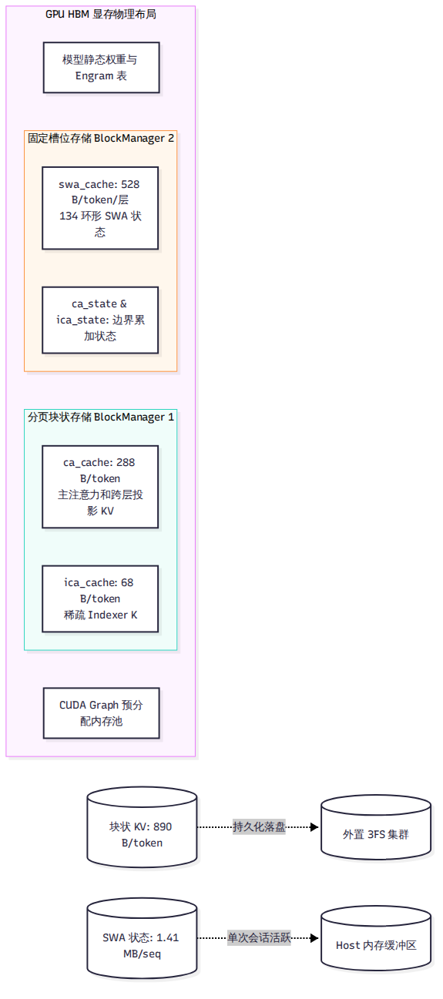
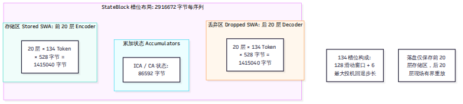

# 第 7 章 KV cache 与状态缓存

在第 3 章中，我们推导出了 V4.1-Flash 单 token 仅需 890 字节块状 KV 的数学定值。但这 890 字节并不是简单地扔进一块连续数组里就万事大吉了。由于模型同时拥有多层跨层共享的块状 KV、全 40 层的滑动窗口注意力（SWA）以及边界累加状态，显存管理器的设计变得极其复杂。本章将深入显存物理布局，拆解 DeepInfer 内部的 5 类核心缓存，剖析 StateBlock 的 134 槽位环形缓冲，并澄清开源版本在“前缀缓存（Prefix Caching）”上的真实实现机制。

---

## 7.1 五类缓存的物理全景

在 `deepinfer/worker/cache_engine.py` 中，显存并不是一个通用的张量池，而是被严格划分为五种不同生命周期、不同存储格式的专用缓存区：

1. **`ca_cache`（Compressed Attention Cache）**：主注意力块状 KV。采用 FP4（E2M1+E4M3 per-16）格式，单 token 占用 288 字节。仅由第 2、8、14、20 四个源层生成，后 20 层跨层共享。
2. **`ica_cache`（Indexed Compressed Attention Cache）**：稀疏索引器（Indexer）专用的 K 缓存。采用 MXFP4（E2M1+UE8M0 per-32）格式，单 token 占用 68 字节。与 `ca_cache` 共同构成了 890 字节块状 KV。
3. **`swa_cache`（Sliding Window Attention Cache）**：滑动窗口注意力状态缓存。采用 MXFP8 格式，每层单 token 占用 528 字节。不采用分页存储，而是按并发请求分配独立的固定槽位。
4. **`ca_state` 与 `ica_state`（压缩边界状态累加器）**：张量形状为 `[slots, ring 6/7, 2, dim]` 的高精度 fp32 累加缓冲，用于维持跨块边界时的加权平均数学连续性。

这种五位一体的布局反映了专用引擎的核心特征：**不同的缓存区由不同的机制驱动，块状 KV 负责跨请求长期留存，而 SWA 状态仅在当前会话的单步迭代中流转。**

---

## 7.2 块状 KV：128 token 对齐与 FP4 压缩

与通用框架通常采用 16 或 32 token 的灵活块大小（Block Size）不同，DeepInfer 在 `deepinfer/model_executor/model_metadata_utils.py:134-135` 中将块大小硬编码为 **128 token**。

### 连续字节带与硬件对齐
在显存物理分配上，一个 Block 并不是高维张量，而是一条被拍扁的 `uint8` 原始字节带：
- 字节带按照运行时的层序切段，每一段严格执行 32 字节对齐。
- 整个 Block 的总字节数被强制向上取整对齐到 $  \text{lcm}(128,   \text{bytes\_per\_token})$，对于 FP4 格式而言，整块大小为固定的 1,152 字节或 4,224 字节。

这种绝对对齐的设计，使得英伟达 Blackwell 架构上的张量内存加速器（TMA）能够以最舒服的 128 字节连续总线突发传输，消除了一切由于非对齐访存造成的带宽惩罚。

### 双层块表管理
为了兼顾 CPU 调度的灵活性与 GPU 内核的执行效率，块表被组织为双层结构：
- **CPU 侧（Host）**：在 C++ `csrc/engine/sequence.hpp:206` 中维护 `std::vector<int>` 稀疏块表，负责分配、释放与引用计数统计。
- **GPU 侧（Device）**：在执行前向计算前，C++ 算子 `prepare_tensor_input_base.cpp` 将块表快速展开为每 token 稠密副本 `[total_q, max_num_blocks]` 的 `int32` 张量，GPU Kernel 无须任何动态指针追踪即可直接根据偏移读取数据。

---

## 7.3 StateBlock：SWA 状态槽与 134 环形缓冲

SWA 的滑动窗口大小明明是 128，为什么在显存规划中，每个序列的状态槽位（`StateBlock`）却固定分配了 **134** 个位置？

### 134 槽位的来历
根据 `deepinfer/worker/cache_engine.py` 的源码约束，134 是经过严密代数推导得出的物理上界：

$$  \text{Slot Size} = W +   \text{MAX\_BACKTRACKING\_TOKENS} = 128 + (  \text{nextn} + 1) = 128 + (5 + 1) = 134$$

在投机解码模式下（第 10 章），系统一次性生成并验证 5 个草稿 token。如果前向验证失败，最差情况下模型需要回退至多 6 个位置（5 个草稿 + 1 个当前 token）。环形缓冲区必须在 128 窗口之外额外预留这 6 个安全槽位，确保发生投机回退时，历史上下文不会被覆盖越界。

### 存储区与丢弃区
每个序列分配的 `StateBlock` 总显存大小固定为 **2,916,672 字节（约 2.78 MB）**，其物理布局严格划分为两部分：
- **存储区（Stored SWA，前 20 层）**：占用 1,415,040 字节（20层 × 134 token × 528 字节）。这是序列的活跃历史记忆，当请求暂停或跨节点流转时，只有这部分数据会被刷入主机内存或 3FS。
- **丢弃区（Dropped SWA，后 20 层）**：同样占用 1,415,040 字节。但在会话暂停或落盘时，这部分数据会被**直接丢弃**。因为依托第 8 章的 SWA 有界重放，后 20 层的 SWA 可以在下次激活时在微秒级内现场重新生成，根本不值得消耗宝贵的外存与带宽。

---

## 7.4 显存容量规划与前缀命中真相

在引擎启动时，系统如何决定把多少显存留给 KV Cache？

### 显存规划公式
在 `deepinfer/worker/cache_engine.py` 中，显存分配公式为：

$$  \text{num\_blocks} = \left\lfloor \frac{  \text{total\_gpu\_memory}   \times 0.90 -   \text{peak\_memory} - 2 \times  \text{state\_bytes}}{  \text{block\_bytes}} 
ight
floor$$

系统为静态状态槽预留 308 个 `StateBlock`（对应 256 个并发序列安全余量），随后在多卡之间取平均值并向下对齐为偶数。整个显存的高水位线（Watermark）被严格限制在 90%，防止大 Batch 突发时发生 CUDA OOM 崩溃。

### 开源版有前缀缓存吗？
许多开发者以为部署 DeepInfer 就能自动享受类似 vLLM 的自动前缀缓存（Prefix Caching）。

查验源码后的真实结论是：**开源版代码内部并没有内置任何自动前缀树（RadixTree）或块哈希查找机制。**
- `csrc/engine/block_manager.hpp` 内部仅包含空闲双链表与引用计数器，不持有任何哈希索引。
- 代码中所谓的 `prefix_caching_hit`，在开源树中仅仅是用于支持同一 Prompt 分支采样（Fork Sequence）时的显式块共享（Copy-On-Write 机制）。
- 真正的跨请求自动前缀匹配，依赖的是第 13 章未开源的外部 Entrypoint 网关与 3FS 存储集群。开源引擎仅仅对外预留了 `cached_hit_tokens` 与 `fork_seq` 等底层注入插槽。

---

## 7.5 vLLM 和 SGLang 怎么做

在通用框架中，前缀缓存与多形态 KV 的管理走出了不同的路线：

- **vLLM**：依托 PagedAttention，并自研了基于哈希的前缀缓存机制（Automatic Prefix Caching，APC）。vLLM 将每个 Block 之前的所有 token 连同当前 block 内容计算 SHA256 哈希值，构成链式索引。在处理 SWA 混合模型时，vLLM 引入了分类型的 Cache Spec。
- **SGLang**：以前缀树（RadixAttention）闻名业界，并在最新架构中升级为 `UnifiedRadixCache`（树核心采用 Rust 编写，支持 Full、SWA 与 Mamba 组件化解耦）。此外，SGLang 提供了三层存储分级（HiCache：L1 GPU / L2 Host / L3 Storage）。

对比可见：vLLM 与 SGLang 强调的是**在引擎内部原生实现通用的自适应前缀发现与淘汰**；而 DeepInfer 则是**将前缀管理彻底剥离给外置 3FS 存储集群，单机引擎只做最硬核的 128 对齐与 FP4 极速读写**。

---

## 小结

- 显存内严格分立 5 类缓存，块状 KV（890 B/token）与固定槽位 SWA（134 环形缓冲）由双轨管理器独立掌管。
- 块状 KV 强制以 128 token 为单位，以连续 uint8 字节带对齐存放，为硬件级 TMA 突发传输铺平道路。
- 开源版未内置自动前缀匹配树，仅支持显式分支共享，跨请求的前缀命中依赖外部 3FS 存储体系的统一调度。

当缓存命中但唯独缺少局部 SWA KV 时，或者跨层计算需要重构上下文时，该如何处理？下一章，我们将见证 DeepInfer 最精妙的协同设计——SWA 有界重放。
