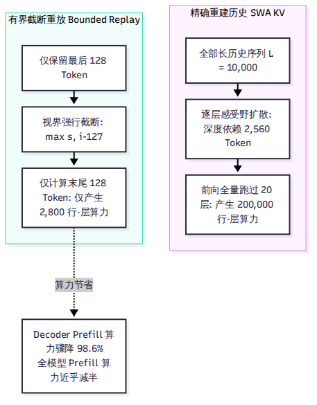
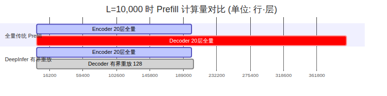

# 第 8 章 SWA 有界重放：只重算最后 128 个 token

如果说 DeepInfer 有哪一个技术点最能代表“模型算法结构与推理系统底层工程的深度协同”，那必然是 **SWA 有界重放（SWA Bounded Replay）**。

在长文本前缀缓存命中或跨层计算时，常规推理引擎面临两难：要么把长达数万 token 的历史全部重新前向一遍以精确恢复局部注意力，要么永久常驻保存所有历史状态导致显存枯竭。DeepInfer 另辟蹊径，利用 V4.1-Flash 的数学结构，以不可思议的**常数计算开销**斩断了历史依赖。本章将完整推导有界重放的数学逻辑、算力减半账本与精度验证证据。

---

## 8.1 什么是 SWA，为什么历史重建代价高昂

滑动窗口注意力（Sliding Window Attention，SWA）的基本定义非常简单：在注意力计算时，每个 Token 不再与前文所有 Token 交互，而仅仅关注距离自己最近的 $W$ 个 Token（V4.1-Flash 中 $W=128$）。

### 逐层累积的感受野黑洞
初看起来，既然只看最近 128 个 Token，恢复状态岂不是只需算这 128 个词？事实并非如此。

在大模型的深层网络中，信息是逐层传递扩散的：
- 第 1 层的 Token 依赖第 0 层的 128 个前文 Token。
- 第 2 层的 Token 间接依赖第 0 层的 $128 \times 2 = 256$ 个前文 Token。
- 到达第 20 层时，其数学感受野（Receptive Field）在理论上已经累积扩散至 $20 \times 128 = 2,560$ 个历史 Token。

正如官方部署问答（`doc:187`）所述：如果要**完全精确**地重建第 20 层的 SWA 状态，系统就必须把最后 2,560 个历史 Token 重新跑过整整 20 层网络。当序列长度达到 10,000 甚至 100,000 时，一旦需要恢复中间状态，系统就不得不付出巨大的冗余前向计算，导致前缀缓存的性能收益大打折扣。

---

## 8.2 有界重放的数学思路：强制截断视界

面对感受野黑洞，DeepSeek 算法团队与系统团队做出了一个极其大胆的设计：**直接在数学上将历史视界暴力截断。**

### 截断公式
在有界重放模式下，模型规定：位于位置 $i$ 的 Query，其能够参与注意力计算的 Key 集合被严格硬性限制在区间：

$$  \text{Key Range}(i) = [\max(s, i - 127), i]$$

其中 $s$ 为重放区间的起始位置。这意味着，对于落在重放窗口内的 Token，它不仅在物理上只看最近 128 个词，而且**绝不允许它向窗口之外的更早历史做任何隐式感受野回溯**。窗口左侧的所有历史被直接视为不存在。

### 代码中的展开实现
在底层算子层面，这种截断并不是通过缓慢的动态布尔掩码（Boolean Masking）实现的。

在 `csrc/engine/prepare_tensor_input_v4.cpp:149-168` 中，C++ 调度器为重放区间的每一行 Query 计算出 4 个紧凑的整数枢轴（Pivots），明确划定历史段与当前 Chunk 段的起止边界。随后，TileLang 算子 `swa_index.py` 将其一次性展开为 `[total_q, 128]` 的稠密绝对索引矩阵。任何落在窗口之外的列直接填入 $-1$，GPU 在加载 Key 向量时直接跳过无效列，没有任何多余的访存开销。

---

## 8.3 两个战场的应用：命中补算与 Decoder Prefill 减半

有界重放机制并非纸上谈兵，它在 DeepInfer 的全流程中精准攻坚了两个核心战场：

### 战场一：Encoder 侧缓存命中补算
在长文本多轮对话中，用户的新请求命中了外置存储集群中已有的 100,000 个 Token 前缀。3FS 存储集群迅速换入了这 100,000 个 Token 的 890 字节块状 KV，但正如第 7 章所述，出于外存带宽考虑，庞大的逐层 SWA 状态并未全量落盘。

此时系统缺失了最后几个 Token 的 SWA 活跃窗口。有了有界重放，系统**不需要把前文重算一遍**，仅仅截取前缀末尾的 128 个 Token 跑一遍前 20 层 Encoder，以微秒级的时间代价现场补齐 SWA 状态，便能立刻无缝进入 Decode 生成。

### 战场二：Decoder 侧 Prefill 算力减半
这是全书最具震撼力的性能账本。回顾第 3 章：V4.1-Flash 的前 20 层为 Encoder，后 20 层为 Decoder（YOCO 架构），后 20 层的块状 KV 直接由第 20 层末端的隐藏状态一次性投影生成。

这意味着：**后 20 层 Decoder 在 Prefill 阶段根本不需要生成块状 KV，它们唯一需要的是为后续 Decode 生成阶段准备好末尾 128 个 Token 的局部 SWA 状态！**

我们以一个包含 $L = 10,000$ 个 Token 的长输入为例，列出算力对照账本：

| 计算阶段 | 传统全量 Prefill 计算量 | DeepInfer 有界重放计算量 | 实际节省幅度 |
| --- | --- | --- | --- |
| **前 20 层 Encoder 算力** | 20 层 × 10,000 = 200,000 行·层 | 20 层 × 10,000 = 200,000 行·层 | 0%（必须全量抽取语义） |
| **后 20 层 Decoder 算力** | 20 层 × 10,000 = 200,000 行·层 | 20 层 × 140 = **2,800 行·层** | **直降 98.6%（71.4 倍收益！）** |
| **全模型 Prefill 总算力** | 400,000 行·层 | **202,800 行·层** | **整机算力削减 49.3%（接近腰斩）** |
| **中间 SWA 显存写流量** | 100.7 MiB | **1.41 MiB** | **访存写流量下降 98.6%** |

通过有界重放，在处理 $L=10,000$ 的长文本输入时，整整 20 个 Decoder 层的计算直接从 20 万行压缩至 2,800 行。官方文档中宣称的“几乎让 Prefill 总计算量减半”，其背后的物理真相正在于此。

### 134 与 140 参数的精确含义
在环境变量与代码中，经常出现 134 与 140 两个参数：
- **134**：物理与存储的精确下界（128 窗口 + 6 投机回退）。
- **140（`DEEPINFER_YOCO_PREFILL_KEEP_TOKENS=140`）**：DeepInfer 在示例和运行时的默认策略值。它在 134 基础之上额外保留了 6 个 Token 的前缀平滑冗余（$128 + 2 \times 6 = 140$），确保在各种边界切片下均满足 $  \text{KEEP} \ge 134$ 的安全不等式。

---

## 8.4 精度等价性验证：模型会变笨吗？

任何工程师在听到“强行把注意力截断、强制舍弃深层历史感受野”时，脑海中浮现的第一个问题必然是：**这样干难道不会破坏模型输出的质量，让模型变笨吗？**

### 1. 训练与系统的先验协同
答案是否定的。因为 DeepSeek 在模型后训练（Post-Training）阶段，就已经在数据流水线中显式加入了有界重放的截断模拟。换言之，模型在训练时就已经习惯了这种“局部 SWA 视界被强行裁剪为 128”的环境，并学会了将长程宏观语义全部委托给第 20 层的全局隐状态。

### 2. 代码算子等价性测试
在仓库 `examples/yoco/yoco_equiv.py` 中，DeepSeek 提供了两级严密的单元校验：
- **L1 级测试**：在 10 种不同形状（单请求、多批次、带 Padding、带 Chunking）下，验证切除无用行的紧凑张量算子（Compact View）与全量 Mask 算子的数学输出逐元素绝对等价。
- **L2 级测试**：在多 GPU 环境下以 Teacher-Forcing 模式逐位比对全流程的 Logits、Top-K 概率与置信度评分。

### 3. 第三方独立评测数据
在 vLLM 官方博客与社区 PR #58132 对 V4.1-Flash 的独立评测中，针对开启与关闭 YOCO 有界截断的数学基准测试进行了严格横评：
- **GSM8K 数学推理得分**：开启截断为 0.9249，关闭截断为 0.9303，差异完全处于标准统计误差（Standard Error，$  \text{SE}=0.0072$）范围之内。
- **GPQA 权威问答评测**：精度波动小于 1.5 SE。

实验数据有力证明：在训练期预先适配的前提下，这种激进的工程近似并没有损伤模型的核心推理能力。

---

## 8.5 vLLM 和 SGLang 怎么做

在 DeepInfer 开源之后，有界重放的设计思想迅速引发了通用框架的跟进：

- **vLLM**：在 PR #58132 中合入了针对 YOCO 结构的截断支持（`yoco_truncation`），允许在部署 V4.1-Flash 时通过参数启用类似的 Prefill 截断以降低显存和计算耗时。
- **SGLang**：在发布针对 V4.1-Flash 的专用方案镜像时，将该特性整合进了其离线和在线优化流水线中。

但与通用框架将有界重放视为“特定模型的特殊优化插件”不同，在 DeepInfer 中，这一机制是深深烙印在整个引擎骨架内部的原生血液。

---

## 小结

- SWA 有界重放用常数 128 窗口强行斩断感受野扩散，消除了长文本历史状态重建的计算爆炸。
- 在 Decoder 侧 Prefill 阶段，它将后 20 层的算力开销砍掉了 98.6%，直接使全模型长文本 Prefill 计算量降低接近 50%。
- 模型在后训练阶段预先学习了截断分布，实测评测证明其对模型推理能力的影响在统计误差范围之内。

解决了单节点内部的调度与算力压缩后，我们需要重新面对多卡分布式的世界。下一章，我们将剖析 DeepInfer 如何在数十张显卡上组织专家并行与动态负载均衡。
