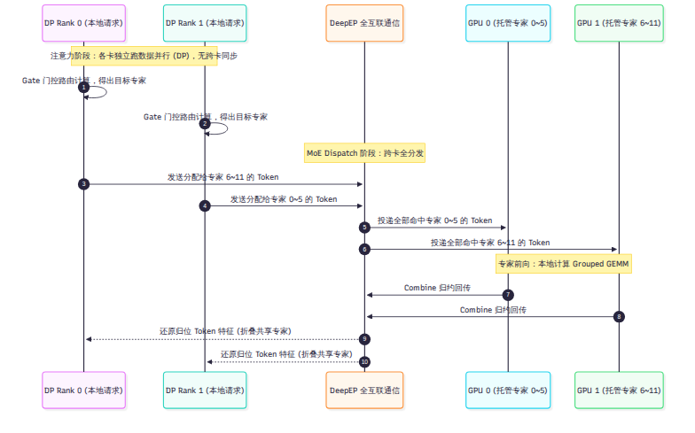
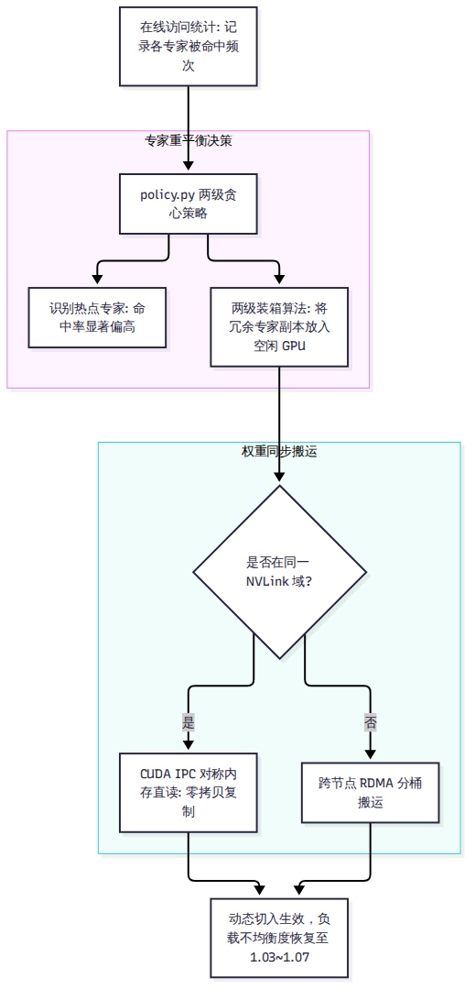

# 第 9 章 并行：注意力用数据并行，专家用专家并行

在拥有 763B 参数的混合专家模型（MoE）面前，单卡显存甚至无法装下它的静态权重。但如果只是简单地把模型横切或者纵切，网络通信开销会立刻成为新的吞吐黑洞。本章探讨 DeepInfer 的分布式并行体系：它彻底摒弃了主流框架常用的张量并行（TP），采用“Attention 做数据并行（DP），MoE 做专家并行（EP）”的正交混合模式，依托宽专家并行（Wide-EP）大幅压降权重访存，并通过两级贪心 EPLB 算法与对称内存（`symm_mem`）实现了运行期动态专家重平衡。

---

## 9.1 混合切分：DP-Attention 配合 EP-MoE

在 `deepinfer/model_executor/parallel_utils/parallel_state.py` 中，系统的通信拓扑被严格划分：

### 1. 并行度严格对齐
系统规定：注意力的数据并行度（`dp_size`）与专家的并行度（`ep_size`）严格相等。全局进程的 Rank 映射完全遵循三维网格公式：

$$  \text{Global Rank} = (  \text{replica}   \times   \text{dp} + r)   \times   \text{cp} + c$$

在没有开启上下文并行（`cp_size=1`）的常规模式下，GPU 数量就等于数据并行度与专家并行度。

### 2. 注意力阶段：绝对独立的纯本地计算
在计算多头潜在注意力（MLA）与滑动窗口注意力（SWA）时，每一张 GPU 完全作为一个独立的数据并行节点运作。
- 各张卡处理分配给自己的独立请求序列，互相之间没有任何集合通信（没有 `All-Reduce`，也没有 `All-Gather`）。
- 由于各卡上的请求长度不同，各个 DP 节点独立在本地对齐批次，并自主挑选匹配的 CUDA Graph 档位。卡间仅在每步开始前通过一次极轻量的 `MIN` All-Reduce 投票对齐当前的步型（Prefill 还是 Decode）。

### 3. MoE 阶段：全互联分发与汇合
一旦张量进入 MoE 专家层，计算模式立刻发生剧变：
- **门控分发（Dispatch）**：每张卡上的门控网络计算出当前输入 Token 选中的 6 个路由专家编号。随后，调用底层 `vendor/DeepEP` 通信库执行跨卡 All-to-All 全互联通信，将 Token 向量精准投递至对应专家所在的 GPU。
- **专家前向（Forward）**：各卡接收来自全集群投递过来的 Token 批次，在本地调用 `DeepGEMM` 执行高效的分组矩阵乘法（Grouped GEMM）。与常规框架不同，DeepInfer 的共享专家（Shared Expert）与路由专家并行计算，不占用独立通信。
- **归约汇合（Combine）**：计算完毕后，再次调用 DeepEP 将专家输出跨卡汇总回原始卡，并在通信归约的 Epilogue 阶段直接将共享专家的输出折叠进去（`bias = shared_out`），省去了一次额外的显存写回。

---

## 9.2 Wide-EP：宽专家并行的算力账本

为什么 DeepInfer 要将 Decode 阶段的专家并行度拉升至 64 甚至 128 张卡？

### 访存量压降 7.43 倍的物理真相
在 Decode 阶段，单步生成的本质瓶颈是显存带宽。我们对比 8 卡小集群（EP8）与 64 卡超节点（EP64）在托管 384 个专家时的真实访存负荷：

| 评估指标 | EP8 并行配置 | EP64 并行配置（Wide-EP） | 物理变化与收益 |
| --- | --- | --- | --- |
| **单卡托管专家数** | 48 专家（带冗余约 52 个） | **6 专家（带冗余约 7 个）** | **单卡专家权重减少至 13.5%** |
| **单步权重访存量** | 约 55.4 GB/卡 | **约 7.46 GB/卡** | **单步显存搬运量暴降 7.43 倍！** |
| **通信域大小** | 单机 8 卡 NVLink 环 | 64 卡跨机 NVLink / 专用网络 | 通信连接数扩大 8 倍 |
| **硬件瓶颈属性** | 严重卡死在显存带宽上限 | 瓶颈转移至网络通信与小算子启动 | 通信被有效重叠在计算背后 |
| **单卡输出吞吐量** | 基线（1.0×） | **提升 1.05× 至 1.53×** | **净吞吐提升 5% 到 53%** |

如上表所示，虽然 64 卡互联导致通信拓扑变大，但将单步权重搬运量砍掉 7 倍以上的巨大收益，远超通信带来的边际延迟。这就是 DeepSeek 坚决在生产环境中推行 64–128 卡物理超节点部署的底层经济学依据。

---

## 9.3 动态调度：EPLB 算法与 NVLink 权重搬运

在真实的推理场景中，用户提问往往具有极强的专业领域集中性（例如全网大量用户同时在写代码或做数学题）。这会导致负责代码和数学的某几个专家被极高频地选中，而大量日常对话专家无人问津。被选中的 GPU 瞬间算力过载，而其他 GPU 只能空转等待，这就是 **专家负载不均衡（Expert Imbalance）**。

### 1. 两级贪心策略（`policy.py`）
为了根治热点，DeepInfer 在 `deepinfer/model_executor/eplb/policy.py` 中实现了专家负载均衡器（Expert Parallelism Load Balancer，EPLB）：
- 系统在每张卡上保留微量冗余专家插槽（Prefill 模式默认预留 16 个，Decode 模式预留 4 个）。
- 在线监控器以滑动窗口统计各个专家的实时命中频次。
- 调度器采用两级贪心装箱算法：第一级根据全局命中率，计算出最热的专家应当复制多少份冗余副本；第二级以最小化所有计算步中“最大单卡负载”为目标，将热门专家副本均匀分配到当前最空闲的 GPU 上。

### 2. 借助对称内存（`symm_mem`）的极速权重搬运
一旦决定将某个专家从卡 A 复制到卡 B，几百兆的权重矩阵如何在不中断服务的前提下搬运过去？
在 `deepinfer/model_executor/eplb/shuffle.py` 中：
- 如果卡 A 与卡 B 处于同一个机内 NVLink 域，系统直接调用基于对称内存（Symmetric Memory）的 CUDA IPC 机制，目标卡直接跨总线直读源卡的显存，实现近乎零拷贝的内存镜像复制。
- 仅当发生跨机搬运时，系统才退化为分桶的 P2P 网络传输。

### 3. `moe_lb` 官方数字冲突的真相
在第一波调研（Q01）中，我们发现官方知乎文章记录的均衡度（`1.0320`）与 Q&A 文档记录的数字（`1.074`）不一致。

查阅代码后证实：这是因为源码中实际并存两套评估口径——`stats_logger.py:238-241` 统计的是全局最大负载与均值比率（$\sum \max / \sum \text{mean}$），而 `eplb/__init__.py:310` 统计的是单卡绝对平衡度 `rank_balance`。两套数字均属真实实测，反映的是不同统计窗口和评估粒度下的健康水平（通常控制在 1.03 到 1.07 之间，表明负载极其均衡）。

---

## 9.4 因果平衡：Mirror CP 上下文并行

长文本 Prefill 往往需要将单请求切分到多张卡上，这称为上下文并行（Context Parallelism，CP）。

### 因果自注意力的几何倾斜
在自回归因果模型中，第 1 个 Token 只能看自己（计算量为 1），而第 10,000 个 Token 可以看前文所有 10,000 个词（计算量为 10,000）。因果注意力矩阵是一个下三角矩阵。

如果简单地按先后顺序将长序列切成 4 份分给 4 张卡：
- 卡 0 分到序列头部，计算量极小（梯形顶端的小三角形）。
- 卡 3 分到序列尾部，计算量极大（底部的完整梯形）。卡 0 算完早早闲置，整机算力被卡 3 拖慢。

### 对偶镜像切分（Mirror CP）
在 `tilelang_ops/prepare_cp_mirror.py` 中，DeepInfer 实现了被称为 **Mirror CP**（代码中亦称 Zigzag 切分）的对称方案：
- 系统将长序列等分为 $2 \times  \text{cp}$ 块。
- 对于第 $r$ 号 Rank，系统分配给它的不是连续的一段，而是第 $r$ 块与第 $2 \text{cp} - 1 - r$ 块的一头一尾对称组合。

通过这种“首段轻负载 + 尾段重负载”的对偶捆绑，每一张 GPU 所分担的因果 $(Q, K)$ 计算对总数被精确拉平，彻底消除了下三角注意力在分布式环境下的几何倾斜。

---

## 9.5 vLLM 和 SGLang 怎么做

在超大规模 MoE 并行领域，通用框架的演进十分迅速：

- **SGLang**：是最早将 DP-Attention 与 DeepEP 通信库集成为标准特性的框架之一（自 PR #1970 起合入）。SGLang 支持灵活配置 `--attn-dp-size`，并针对 V4.1-Flash 推出了专门优化的全互联通信镜像。
- **vLLM**：在最新的版本演进中，vLLM 引入了双层专家并行（Dual-level Expert Parallelism，DEP），支持在节点内做 TP/EP，在节点间做更宽的通信分发，并在 Recipes 中逐步吸纳了 EPLB 的动态负载重排思想。

与通用框架需要通过复杂的命令行参数自适应检测不同网络拓扑不同，DeepInfer 的代码从一开始就将 DeepEP 与对称内存写死在核心执行流中，以放弃通用拓扑为代价，换取了无条件的最短代码路径。

---

## 小结

- DeepInfer 在分布式上坚决推行“Attention 纯数据并行 + MoE 纯专家并行”，彻底剔除了张量并行（TP）的高频同步阻塞。
- 宽专家并行（EP64–128）将单步权重加载量压缩至 EP8 的 $\frac{1}{7.43}$，在硬件物理层面攻克了 Decode 访存瓶颈。
- EPLB 算法通过两级贪心装箱与对称内存（`symm_mem`）直读，解决了动态热点专家的倾斜问题；Mirror CP 则抹平了因果注意力的几何负载差异。

除了在多卡之间高效搬运专家权重，如何在单张卡内部让模型生成得更快？下一章，我们将剖析 DeepInfer 的加速利刃——DSpark 变长投机解码。
