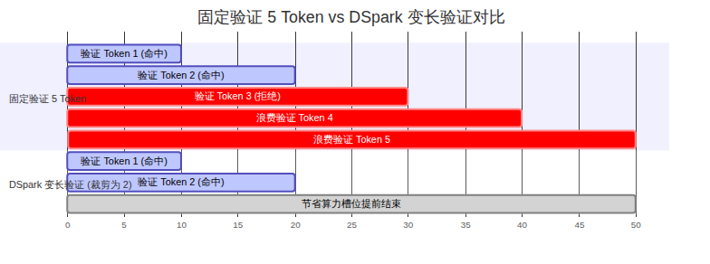
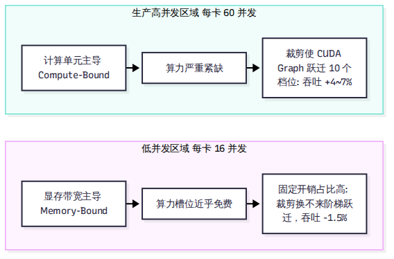

# 第 10 章 投机解码：DSpark 与按置信度安排验证

在大模型自回归解码（Decode）中，常规做法是每一步只让大模型输出一个 token。为了打破这种单步单词的低效，投机解码（Speculative Decoding）让小草稿模型先行猜测若干候选词，再由大模型一次性并行验证。

然而，在工业级大规模并发服务中，传统的固定长度验证策略（例如所有请求一律验证 5 个 token）反而会拖慢整体吞吐。本章深入剖析 DeepInfer 的投机解码体系：它基于非因果并行草稿模型 **DFlash**，融合创新的 **DSpark** 变长验证算法，通过置信度评分动态裁剪验证前缀，并在生产饱和并发下实现了 4% 到 7% 的系统净吞吐提升。

---

## 10.1 传统投机的困境：固定长度的算力浪费

在理想状态下，草稿模型如果猜出 5 个 token 且全部被主模型接纳，解码速度就能提高数倍。然而在真实业务中，长文本的复杂逻辑往往导致草稿预测的接受率（Acceptance Rate）波动剧烈。

### 固定步长的算力惩罚
如果系统对所有请求固定验证 5 个 token：
- 假设某个请求在第 2 个 token 就预测错误被主模型拒绝，按照因果自回归规律，后续已经算完的第 3、4、5 个 token 的算力就全部白费了。
- 在单卡并发序列数达到 60 乃至 100 的生产高负载场景下，如果每个请求都强制塞入 5 个验证 token，单批次的 Token 总数会迅速膨胀到数百甚至上千。
- 此时，GPU 的瓶颈发生物理转移：它不再受限于显存带宽，而是直接被巨量的无效投机验证填满，撞上了张量计算单元（Tensor Core）的算力天花板。

盲目地多猜多验，在生产高并发下反而会恶化每步延迟。系统迫切需要一种机制：**能够在前向计算发生之前，精准预测哪些草稿词胜算较高，并主动砍掉那些胜算极低的尾部候选词。**

---

## 10.2 DFlash：非因果并行草稿生成

在了解如何裁剪验证之前，我们必须先看清草稿 token 是如何以极低代价生成的。

V4.1-Flash 的草稿生成基于 **DFlash** 架构（对应学术成果 arXiv:2602.06036，UCSD Jian Chen 等人工作）。它并没有引入一个独立外挂的小模型（如传统 EAGLE 系列），而是直接在主干模型顶部挂载了 3 个轻量级的草稿 Transformer 层（层号 40、41、42，定义于 `deepinfer/model_executor/models/mtp/dflash.py`）。

### 一次前向产出 5 个候选词
与传统小模型需要串行自回归前向 5 次不同，DFlash 是一次性、块级并行前向：
- **输入构造**：输入由 1 个真实 Token（Golden Token）与 4 个噪声占位符（Noise Tokens）拼接而成，张量长度固定为 5（`dspark_block_size = 5`）。
- **块内非因果双向注意力**：在 `get_kv_index.py:183-197` 中，5 个草稿位置共享同一份针对主干历史的注意力索引，并在 5 个候选槽位内部执行双向注意力。
- **单步出全块**：DFlash 仅仅经历 3 个轻量层的计算，便在单次前向中同时输出了未来 5 个位置的草稿表征向量。块内缺乏单向因果掩码带来的语法漂移，由采样时内置的一个秩为 256 的马尔可夫头（Markov Head）予以补偿。

---

## 10.3 DSpark 核心：置信度头与边际收益曲线

拿到 5 个草稿 Token 之后，验证多少个才是全局最优？这就是 **DSpark** 算法（对应学术论文 arXiv:2607.05147，DeepSeek-AI 与北京大学联合研究）的核心使命。

### 1. 置信度头（Confidence Head）
在 DFlash 的最后一层，模型配备了专门的置信度投影层（定义于 `mtp/dflash.py:46-79`，参数名为 `mtp.2.confidence_head.proj.weight`，形状为 `[1, 5376]`）。
置信度头为每一个草稿 Token 输出一个标量概率值 $p_i \in [0, 1]$，代表该位置草稿能够通过主模型验证的置信度。由于自回归必须从前向后连续接纳，第 $k$ 个 Token 能够存活的联合概率为累乘值：

$$P(  \text{accept } k) = \prod_{i=1}^k p_i$$

### 2. 边际收益与吞吐曲线优化
在 `csrc/engine/mtp_varlen.hpp:150-267` 中，系统维护了一张实测的 GPU 延迟性能表。该表记录了当前硬件在不同 Token 批大小（`total_q`）下的真实步耗时曲线 $T(  \text{total\_q})$。

对于批次中的每一个请求，调度器计算其边际验证收益：

$$  \text{Marginal Throughput} = \frac{\mathbb{E}[  \text{Accepted Tokens}]}{T(  \text{total\_q})}$$

算法按贪心原则，优先为联合生存概率高、边际产出大的请求分配更长的验证长度，而对置信度断崖下跌的请求，坚决将其验证长度从 5 截断至 2 或 3，甚至直接截断至 1（退化为单字生成）。

### 3. GPU 就地重排算子
正如第 6 章所揭示的，为了避免在异步调度（ZOS）下等待置信度回传 CPU，这一求解过程在 GPU 内部由 TileLang 编写的 `compute_seqlens_q_by_confidence_rates` 算子就地执行。GPU 算子在保持批次总 Token 数严格锁定的前提下，动态重配各序列的 `seqlens_q`，完美契合了 CUDA Graph 的静态档位。

---

## 10.4 数据表深度拆解：为什么低并发亏、高并发赚

在官方部署文档中，DeepSeek 公布了一组详实的 DSpark 实测对照表。许多开发者在阅读该表时常常感到困惑：为什么在低并发时变长验证反而吞吐下降，而只有在饱和并发下才显现出威力？

我们提取官方实测核心工作点数据进行物理拆解：

| 单卡并发序列数（Concurrency） | 固定验证平均长度 | DSpark 变长验证平均长度 | 平均接受 Token 长度 | 相对吞吐收益 | 真实物理瓶颈与解释 |
| --- | --- | --- | --- | --- | --- |
| **16（极低负载）** | 5.0 | 4.41 | 3.29 → 3.21 | **-1.5%（略微亏损）** | **访存受限（Memory-Bound）**：计算单元大面积闲置，“多算几个验证 Token 近乎免费”。截断带来的耗时缩短极小，无法抵消接受长度损失 2.4% 的负面影响。 |
| **32（中等负载）** | 5.0 | 3.92 | 3.29 → 3.25 | **+1.8%（微弱盈利）** | **瓶颈过渡区**：算力开始收紧，算力节约与接受率微降达到平衡拐点。 |
| **60（生产标准工作点）** | 5.0 | 3.48 | 3.29 → 3.27 | **+4.8%（显著增益）** | **算力受限（Compute-Bound）**：GPU 计算核心完全打满。将批次总 Token 压低后，CUDA Graph 跨越了近 10 个等距档位，步耗时大幅缩短，净吞吐提升立竿见影。 |
| **96（超高负载极限）** | 5.0 | 3.21 | 3.29 → 3.26 | **+7.1%（极限增益）** | **严重算力赤字**：无效验证被大规模剔除，系统在极限吞吐下维持了稳定的高步频。 |

这一组物理数据给出了极其严肃的工程教训：**没有无条件的加速算法。DSpark 变长验证的本质是在算力紧缺的生产工作点上，通过以微小代价（接受长度下降不到 1%）换取计算批次的大幅精简，进而激活 GPU 步频提升。如果在个人单卡或极低并发下运行，应当主动关闭变长验证以避免负优化。**

---

## 10.5 vLLM 和 SGLang 怎么做

作为大模型推理加速的通用武器，投机解码在各大开源框架中均有重要布局：

- **vLLM**：支持极其广泛的投机方式，涵盖基于小模型的 EAGLE-1/2、Medusa、MLP 草稿头、N-gram 匹配以及 MTP 模块。在 PR #62840 中，vLLM 社区迅速发起了对 DSpark 置信度头 TileLang 算子的移植与跟进，引入了类似的主动验证裁剪机制（Adaptive Verification）。
- **SGLang**：支持丰富的投机解码生态，并在针对 V4.1-Flash 的支持镜像中集成了 DSpark 的延迟校正内核，配合其底层的 RadixAttention 实现了高效的树状草稿验证。

与通用框架需要通过复杂的抽象层兼容多种不同的草稿生成结构不同，DeepInfer 的代码直接将 DFlash 的 3 层拓扑与 DSpark 的延迟优化器深度固化，在单一赛道上实现了最小的运行时损耗。

---

## 小结

- 传统的固定长度投机在生产大并发场景下会因大量无效验证而挤爆 GPU 算力，导致整体吞吐不增反降。
- DFlash 依托挂载在主干上的 3 个草稿层，以非因果块内双向注意力一次性并行产出 5 个候选 Token。
- DSpark 利用置信度头计算联合存活概率，结合 GPU 延迟曲线动态将验证长度压缩至 3.2–4.4，在生产饱和工作点换取了 4% 到 7% 的系统净吞吐增益。

在搞清楚了上层的调度、内存、重放与投机之后，我们必须将目光投向最底层的硬件基石。下一章，我们将探究支撑 DeepInfer 运转的 5 大高性能内核库以及它如何同时驯服 NVIDIA 与昇腾两种芯片。
