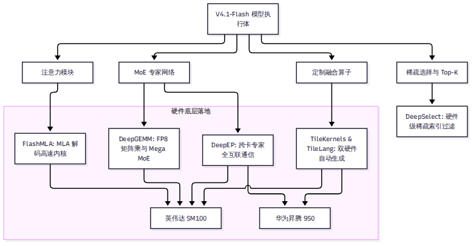

# 第 11 章 内核与硬件：一套引擎，两种芯片

在大模型推理系统的最底层，一切高层设计最终都要落地为 GPU 或 NPU 计算核心（Core）上的汇编指令。

DeepInfer 的独特之处在于：它没有依赖通用的 PyTorch 原生算子，而是将计算底座完全构筑在 5 个高性能自研内核库之上；同时，它凭借新兴的 TileLang 编程语言，成功在英伟达 Blackwell（SM100）与华为昇腾（Ascend 950）两套硬件架构迥异的芯片上实现了算子级统一分发。本章将拆解这 5 大内核金刚的调用现场、剖析 Scale-Up 域内的 Mega MoE 融合算子，并直面开源版 FlashMLA 相比内部自用版的性能落差。

---

## 11.1 五大内核金刚：各司其职的算力底座

在 DeepInfer 的 `vendor/` 目录下，嵌入了 6 个专用的底层开源 Git 子模块（包含英伟达与昇腾专用版本），配合独立发布的 `tile-kernels`，构成了支撑系统的五大算力支柱：

1. **`FlashMLA`**：多头潜在注意力（MLA）的高性能解码内核。在 `deepinfer/model_executor/models/v4_modules/attn.py:617, 660, 994` 等关键位置被直接调用，专门负责低维度共享 Latent 向量的高速注意力计算。
2. **`DeepGEMM`**：针对 FP8 低精度矩阵乘法深度调优的 GEMM 内核库。在模型全流程中承担绝对重任：在 `linear.py:165` 被用于稠密投影，在 `mlp.py:119, 130, 398` 被用于 MoE 专家的门控与第二层 MLP 投影，在 `index_attn.py:299, 317` 被用于稀疏索引投影，并在 `hc.py:270` 支撑 mHC 的残差混洗。
3. **`DeepEP`**：专为超大规模 MoE 专家并行打造的高吞吐通信库。在 `v4_modules/mlp.py:469, 501` 中被直接调用，全权接管跨卡跨节点的 Token Dispatch（分发）与 Combine（汇总归约）全互联通信。
4. **`DeepSelect`**：专用的硬件级 Top-K 与稀疏索引选择库。在 `v4_modules/index_attn.py:216, 361, 494` 中被调用，负责在微秒级时间内从上万个历史上下文块中精准挑选前 512 个最高相关性的候选块。
5. **`TileKernels`**：由 TileLang 自动生成的轻量级融合算子包（通过 pip 安装 `tile-kernels==2.1.0`）。在 `mlp.py:400, 436, 521` 中处理门控激活、缩放对齐以及各种特殊的内存切片重排。

---

## 11.2 TileLang 架构：一套上层接口，两套底层镜像

在深度学习框架中，支持多硬件最容易犯的错误是在上层业务逻辑中充斥着大量的 `if is_cuda(): ... else if is_npu(): ...`。这种写法不仅极难维护，而且极易引入数值不一致。

DeepInfer 采用了一种极其干净的三层分发架构：
- **上层接口层（`tilelang_ops/` 根目录）**：包含 33 个 Python 模块，向模型层暴露完全平台中立的算子函数签名（如 `gather`、`store_kv_cache`、`state_cache`）。
- **动态重定向中枢（`ops.py:13-22`）**：在引擎启动导入时，`ops.py` 检测当前环境的 `PLATFORM.tilelang_ops_backend`，依据当前芯片类型，动态将算子实现的名字级绑定指向底层具体的硬件子目录。
- **底层镜像实现层（`cuda/` 与 `asc/`）**：在 `tilelang_ops/cuda/`（30 个文件，4,968 行）与 `tilelang_ops/asc/`（30 个文件，7,418 行）中，DeepSeek 为两套硬件各自手写了一一对应的 43 个底层算子。两套代码在张量输入输出规范上保持完全一致。

---

## 11.3 硬件特异性差异：TMA 与 Unified Buffer

虽然上层接口保持一致，但在底层的微架构指令排布上，英伟达与昇腾走的是两条截然不同的体系结构道路：

| 硬件维度 | 英伟达 Blackwell（SM100）实现路线 | 华为昇腾 950（Ascend 950）实现路线 |
| --- | --- | --- |
| **异步数据搬运** | 依赖硬件级张量内存加速器（TMA），配合异步屏障（MBarrier）执行非阻塞式直接显存搬运。 | 依赖多核向量引擎的显式指令流水，利用片上统一缓冲区（Unified Buffer，UB）多版本乒乓缓冲。 |
| **并行计算组织** | 依赖 Warp-Specialized 编程范式，将同一个线程块内的线程明确划分为“专门搬数据的 Warp”与“专门算矩阵的 Warp”。 | 采用持续向量核心（Persistent Vector Core）架构，在 TileLang 源码中大量嵌入针对昇腾达芬奇架构的手写 SIMD 指令（`S.v*` 指令达 623 处）。 |
| **数据类型与通信** | 深度依赖 `FP4 E2M1` 与 `int32` 索引；底层进程通信走 NCCL。 | 依赖昇腾专有的 `FP8 x FP4` 混精指令与 `int16` 紧凑索引；通信走 HCCL 集合通信栈。 |
| **功能支持差异** | **全功能支持**：完整支持 Mega Gate、Mega mHC、BF16 Mega MoE、稠密注意力融合以及全流程批不变。 | **轻微裁剪**：昇腾当前版本缺失了部分高阶融合特性（Mega Gate、mHC 融合），部分复杂算子回退为离散流水线。 |

这种深入微架构的定制，保证了代码在英伟达平台上能把 Blackwell 的新硬件特性榨干，而在昇腾平台上也能完全贴合昇腾达芬奇核心的向量指令流水。

---

## 11.4 Mega MoE：Scale-Up 域内的极致融合

在第 9 章的分布式讨论中，MoE 的前向计算被拆分为三个步骤：DeepEP Dispatch → Grouped GEMM → DeepEP Combine。这意味着张量必须在显存中读写至少 3 次，且需要启动 3 个不同的 Kernel。

在单台 8 卡服务器内部（同属于单机高带宽 NVLink 互联的 Scale-Up 域），DeepInfer 启动了一项杀手级优化——**Mega MoE**。

### 单内核融通一切
在 `deepinfer/model_executor/models/v4_modules/mlp.py:184-188` 中，当系统检测到并行域满足 `is_within_nvl_domain`（全组均在机内 NVLink 直连范围内）时，前向计算直接切入由 `DeepGEMM` 提供的 Persistent Mega Kernel：
- **网格大小锁死在物理 SM 数量**：Kernel 启动后常驻在 GPU 计算单元上，不再反复退出。
- **通信与计算在一处完成**：Token 路由分发、L1 投影、SwiGLU 激活函数、L2 降维投影以及跨卡结果汇总归约，被强行熔铸在同一个单一 Kernel 内部完成。
- **零中间显存换出**：Token 向量在片上 SRAM 中流转，完全消除了中间张量写入显存 HBM 再读出的巨大带宽浪费。

官方文档明确指出：在一个 Scale-Up 紧耦合域内，Mega MoE 的性能在物理上总是领先于传统的分离式调用。

---

## 11.5 开源版 FlashMLA 与内部版的差距

在技术评估中，我们必须保持严谨的求真态度：**开源的算子和 DeepSeek 线上内部自用的算子完全一样强吗？**

根据官方技术问答（`doc/inference_deployment_qa.md:233-237`）的坦白披露：
> "The open-source FlashMLA kernel lacks a specialized hand-tuned SASS instruction scheduling optimization that exists in our internal proprietary build."

在英伟达 GPU 汇编体系中，SASS 是直接对应硬件指令发射槽位的底层微码。DeepSeek 内部版本针对 Blackwell 的双发射指令流水线进行了极致的手工 SASS 微码重排：
- **微观算子差距**：由于缺少这一层专属手工 SASS 调优，开源版 FlashMLA 的单算子解码内核（Decode Kernel）比内部生产版本**慢 5% 到 10%**。
- **宏观端到端差距**：但因为注意力计算在端到端整步时间中仅占一部分（大部分耗时仍由 MoE 专家网络占据），这一微观差距在端到端整机吞吐量上被大幅稀释，**最终整机性能落差不超过 5%**。

这种开诚布公的工程坦白，恰恰为我们评估开源基准提供了极为宝贵的客观校准坐标。

---

## 小结

- DeepInfer 的算力底座完全依托 FlashMLA、DeepGEMM、DeepEP、DeepSelect 与 TileKernels 五大高性能库。
- 采用 TileLang 统一接口，通过底层 `cuda/` 与 `asc/` 30 对镜像算子，实现了在英伟达 Blackwell 与华为昇腾 950 上的深度微架构适配。
- 在机内 NVLink 域，Mega MoE 实现了将通信、GEMM 与激活函数熔铸于单一持久化内核的极致融合；开源版 FlashMLA 虽略缺 SASS 微调，但端到端性能差距依然锁定在 5% 以内。

有了极致的计算速度，推理系统还必须保证另一个核心命题：**计算结果是否值得信赖？** 下一章，我们将探讨 DeepInfer 如何保证结果在不同批次下绝对可复现，并实现强约束的结构化输出。
