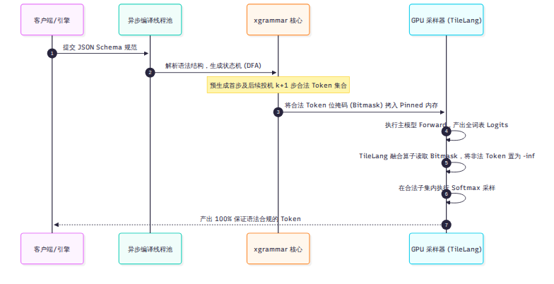

# 第 12 章 结果可信：批不变、确定性采样与结构化输出

在严谨的技术评测或对确定性要求极高的金融、法律、数学代码场景中，开发者常常会遭遇一个令人崩溃的现象：**同一个 Prompt、固定了相同的随机种子（Seed），仅仅因为当前批次（Batch）里混入了几个其他用户的随机请求，模型输出的内容就发生了改变！**

这种不可复现性不仅给学术基准测试带来了巨大干扰，也在生产落地中埋下了合规隐患。本章将剖析 DeepInfer 如何对抗浮点非结合律实现“批不变（Batch-Invariant）推理”、如何实现绝对严格的确定性采样，以及如何基于 xgrammar 自动机实现 100% 格式合规的结构化输出。

---

## 12.1 批不变推理：浮点非结合律的工程反击

同样的输入，在单并发时和在 64 并发时，为什么会在某些 token 处发生概率分叉？

### 浮点运算的非结合律
在计算机底层，IEEE 754 浮点数加法并不满足数学上的结合律：

$$(a + b) + c 
eq a + (b + c)$$

在追求极致性能的通用推理引擎中，许多算子（如矩阵乘法的 split-K、注意力的 split-KV 以及多 GPU 通信归约）为了打满并行度，会根据当前批次的大小动态决定切分多少个并行线程块（CTA）。
- 当 Batch 大小时，数据被切分成 4 个块在并行树上做规约加法。
- 当 Batch 变小时，数据被切分成 2 个块做规约加法。

累加顺序的微小改变，在第 7 位有效数字（单精度）或第 3 位有效数字（半精度）上引入了极其微弱的舍入漂移（1 ULP 误差）。经过 40 层深层网络的逐层非线性放大，最终可能导致两个极具竞争力的词之间的 Logits 发生翻转，从而产生完全不同的输出。

### DeepInfer 的批不变硬核改造
在 `deepinfer/environ.py` 中，开启 `DEEPINFER_BATCH_INVARIANT=1` 时，引擎会启动一套严格的确定性约束：
1. **FlashMLA 禁用 split-KV**（`sparse_decode.cpp:223`）：注意力计算强制单线程块单调规约，禁止按批次动态切分 KV 块。
2. **DeepGEMM 锁定确定性模式**（`gemm.hpp:519`）：禁用 NVIDIA cuBLASLt 的启发式搜索，强制关闭 split-K 拆分，锁定固定切片算法。
3. **DeepEP 禁用多重归约**（`userbuffer.py:79`）：关闭 `allow_multiple_reduction`，跨卡通信汇总始终遵循固定的 Rank 递增单调加法树。
4. **定点整数采样**：在采样算子中，使用定点 `uint32` 整数累积分布函数（CDF）代替浮点累加，所有概率比较全部转化为严格的绝对整数比较。

通过这四道硬锁，DeepInfer 保证了单个请求的每一个中间计算结果，与同批次中是否有其他请求、有多少其他请求完全解耦。代价正如 CLI 命令行帮助信息所诚实标注的：系统将失去部分高级并发加速算子，整体推理速度会变慢（`slower`）。

---

## 12.2 确定性采样与 RNG 定序

除了浮点累加误差，另一个破坏复现性的是伪随机数生成器（RNG）的状态污染。

### 1. 绝对位置绑定 RNG
在 `deepinfer/model_executor/layers/sampler.py` 中，DeepInfer 彻底废弃了依赖全局调用次数推进 RNG 步长的做法：
- 随机数生成器的种子（Seed）直接与当前请求的序列身份标识以及当前 Token 在序列中的**全局绝对位置（`seqlen_k`）**强行绑定。
- 在采样第 $K$ 个词时，无论该请求之前经历过几次投机回退、无论它是在哪个时间步被调度，RNG 产出的随机数序列都是唯一的数学单调函数。

### 2. 为什么确定性模式必须强行关闭变长 MTP？
在启动确定性模式时，引擎会强制断言关闭第 10 章的 DSpark 变长验证（`DEEPINFER_ENABLE_MTP_VARLEN=0`）。

其底层物理原因极其深刻：
- 回顾第 10 章：DSpark 的验证预算分配是**全批次联合排名最优求解**。
- 如果请求 A 的变长验证长度取决于同批次其他请求的置信度高低，那么同批请求的构成改变，就会导致请求 A 本次分配到的验证 token 数发生变化（例如上一次验证了 3 个，这一次验证了 2 个）。
- 这种由于外部批次引起的验证长度波动，直接打破了确定性采样的前提。因此，追求绝对可复现时，系统必须强制回退至固定长度验证。

---

## 12.3 结构化输出：xgrammar 语法掩码与投机前瞻

在让大模型输出特定 JSON Schema、SQL 语句或工具调用代码时，如何 100% 保证输出格式绝不越界？

### 1. 基于 xgrammar 的异步预编译
DeepInfer 在 `deepinfer/structure_output/` 中集成了学术界广泛使用的 **xgrammar** 语法引擎：
- 当用户提交 JSON Schema 或上下文无关文法（CFG）时，引擎后端的异步编译线程池将其解析并编译为确定性有限状态自动机（DFA）。
- 自动机时刻追踪当前已经生成的语法路径，并在微秒级内推导出“当前状态下，全词表中哪一部分 Token 是合法字符，哪一部分 Token 会导致语法破损”。

### 2. Pinned 位掩码与投机前瞻
为了不拖慢 GPU 计算，系统在 CPU 侧生成紧凑的位掩码（Bitmask，每个 Token 对应 1 个 bit），并通过 Pinned 锁页内存高效下发。
- 在配合投机解码运行时，自动机甚至会预先计算出未来 $k+1$ 步的所有潜在合法掩码。一旦发生投机拒绝，自动机能够精准执行状态回滚（Rollback）。
- GPU 在采样前，调用专用 TileLang 算子直接读取 Bitmask，就地将所有非法 Token 的未归一化对数概率（Logits）强行写为 $-\infty$。

在经过这一步物理掩码过滤后，非法 Token 的发生概率被绝对清零，从根本上杜绝了括号不匹配、字段缺失等模型幻觉。

---

## 12.4 正确性基线：PPL 全等与 AIME 评测

推理系统在经历了激进的 FP4 量化、SWA 有界截断以及算子融合后，如何向用户自证“这套系统输出的结果在精度上没有被跑坏”？

### 1. 浮点逐位全等（Bitwise PPL Check）
在 `tests/models/offline_decode_ppl.json` 中，DeepSeek 固化了一组极为严苛的数值指纹：
- 覆盖 2 套硬件平台（NVIDIA 与 昇腾）、2 类典型负载、2 个 DP Rank，共计 60 个单精度浮点数基准值。
- 在执行基线回归测试（`test_kl.py`）时，系统要求计算出的 Kullback-Leibler 散度满足 `max_kl == 0.0`，这意味着不仅生成文本必须相同，每一个 Token 的前向 Logits 必须做到逐 bit 级别的浮点全等。

### 2. 权威高难度数学评测（AIME / GPQA / HLE）
在 `eval/` 目录下，DeepSeek 提供了完整的主流严苛数学与逻辑评测运行流水线。在官方基准测试中，V4.1-Flash 在开启标准优化模式下测得了极高水准的学术分数：
- **AIME 数学竞赛**：99.9 分
- **GPQA 专家级综合问答**：93.4 分
- **HLE-Full（Humanity's Last Exam）**：42.6 分

需要客观指出的是：这组顶尖分数是在**开启 DSpark 变长验证且关闭批不变模式（即追求最高吞吐的极速生产路径）**下实测得到的，反映了模型在生产常规状态下的真实智力上限。

---

## 小结

- 批不变推理通过关闭 split-KV、split-K 与通信多重归约，消除了浮点非结合律引起的批间扰动，保证了结果的绝对解耦与可复现。
- 确定性采样将随机数生成器与序列全局绝对位置强绑定，且必须显式关闭变长投机以杜绝跨请求干扰。
- 结构化输出基于 xgrammar 自动机与 Pinned 位掩码技术，实现了在极低延迟开销下 100% 强制约束输出语法合规。

至此，我们已经剖析完了单节点执行引擎内部的所有核心技术。但在数据中心里，是谁在给这些节点投喂数据？是谁在管理那跨越数天的海量 KV Cache？下一章，我们将正式揭秘 DeepSeek 生产体系中“没有开源的那一半”。
