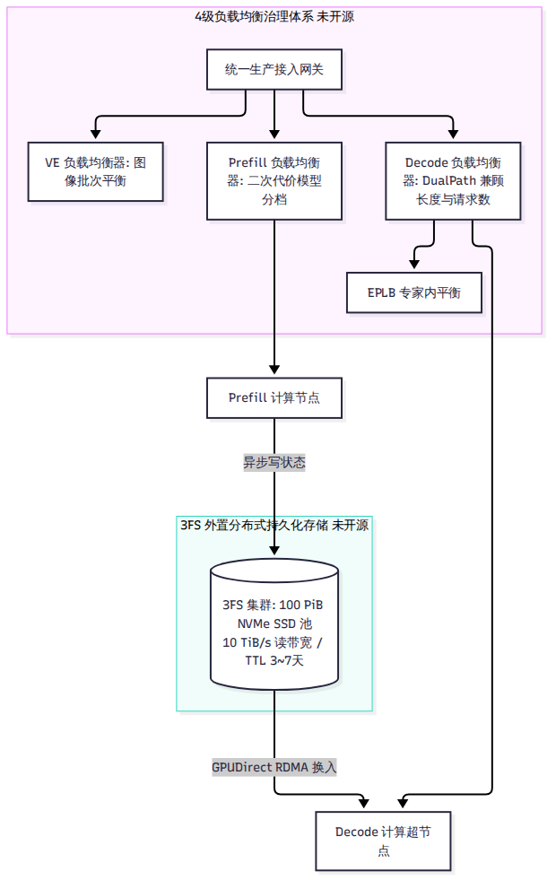
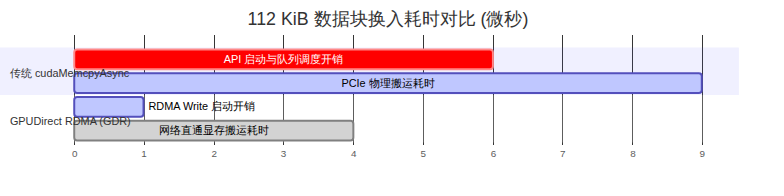

# 第 13 章 没有开源的那一半：负载均衡、KV 存储、弹性与容错

::: warning
本章内容全部整理自 DeepSeek 官方技术文档（`doc/inference_deployment_qa.md`）及官方知乎长文披露。本章所讨论的四级负载均衡器、外置 3FS 存储集群与动态容错体系**在当前的开源 DeepInfer 仓库中均未包含源码**。开源代码仅预留了相关的状态流转插槽与钩子函数。
:::

很多技术团队在研读 DeepInfer 源码时容易产生一个错觉：以为只要把开源仓库编译好，就能立刻在自己的服务器上支撑起千万级的高并发流量。

然而，真实的工业级推理系统是一个庞大的系统工程。DeepInfer 开源的仅仅是单节点的“动力核心”，而真正支撑起每天 155 万亿 token 运转、让成百上千个 GPU 超节点井然有序协作的“中枢神经系统”与“外存循环系统”，依然深藏在 DeepSeek 的数据中心高墙之内。本章将走出引擎单机边界，深度解密这套未开源的大规模生产基础设施。

---

## 13.1 四级负载均衡：各管一段的分层治理

在由上万张计算卡组成的数据中心里，单一大一统的反向代理（如 Nginx、Envoy 或 HAProxy）面对大模型推理流量会彻底失效。因为长文本 Prefill 需要海量浮点算力，流式 Decode 极度消耗显存带宽，而多模态图像处理则完全受限于卷积与小矩阵吞吐。

DeepSeek 在集群入口处构筑了分工极其严密的“四级负载均衡”治理体系：

1. **多模态负载均衡器（Vision Encoder LB）**：专门监控所有独立 VE 机器的并发图像队列。根据图像的分辨率和数量，将图像编码任务均匀切片分发，并在完成特征投影后，将特征张量精准定向推送到后续的 Prefill 节点。
2. **预填充负载均衡器（Prefill LB）**：以算力计算配额（Compute Quota）为核心依据。它并不简单统计请求条数，而是建立复杂的二次代价数学模型，将不同长度的输入 Prompt 智能分档，防止长输入请求堵死同一个计算节点。
3. **解码负载均衡器（Decode LB）**：采用 DualPath 调度理念（参考 ACM SIGCOMM '26 论文体系），同时追踪 64–128 卡超节点内的“活跃请求并发数”与“总 Token 上下文长度”，防止节点由于显存占用过高而引发频繁抢占。
4. **机内专家负载均衡器（EPLB）**：位于每个超节点的引擎内部，根据第 9 章介绍的两级贪心算法，实时监控 384 个专家的命中偏好，动态调整冗余专家插槽并触发机内 NVLink 权重搬运。

---

## 13.2 Prefill 算力配额与二次代价模型

在处理长达 32K 或 128K 的长 Prompt 时，注意力的浮点计算量随着输入长度 $L$ 的增长呈二次方爆炸（$O(L^2)$）。一个 64K 的长文本请求，其消耗的计算资源可能相当于几百个短查询的总和。

### 二次代价公式
为了在毫秒级内评估一个请求对 GPU 的真实压迫，Prefill 负载均衡器引入了二次代价模型：

$$  \text{cost}(q, c) = \alpha \cdot q + \beta \cdot q^2 + \gamma \cdot q \cdot c$$

其中 $q$ 代表本次请求需要计算的新 Token 数量，而 $c$ 代表命中历史前缀的 Token 数量（已缓存部分仅需参与交叉注意力，无须自注意力二次方全量前向）。

### 全局配额求解与 DP 协同
调度器维护一个动态的单节点算力配额上限（`compute_quota_limit`，通常上限配置为 32,768 个等效 Token 算力）。
- 调度器以此模型求解最优请求切片，确保送入同一台 Prefill 机器的批次总计算量严格处于该配额之内。
- 在机内多个数据并行（DP）节点之间，各卡通过一次极轻量的 `MIN` All-Reduce 集合通信，迅速同步当前批次的最大算力承受度，确保批次步频绝对整齐。

正如我们在第 6 章所澄清的：开源版代码中由于剥离了外部调度器，并未包含这一套在线求解器，而是回退到了基于上下文长度和 CP 粒度的启发式切分。

---

## 13.3 3FS 存储集群：100 PiB 与前缀自由

在传统的推理架构中，为了复用前缀缓存，系统通常采用“前缀亲和性路由（Affinity Routing）”：用户 A 的会话之前在哪台机器上跑，后续请求就必须死死绑定到那台机器上。

这种设计在超大规模集群中会导致致命的灾难：某些存放了爆款公共前缀（如热门系统提示词或长文档）的节点被活活打爆，而其他没有缓存的节点却只能闲置。

### 外置 3FS 带来的“前缀自由”
DeepSeek 彻底摒弃了亲和性路由的束缚，建设了一套独立于计算集群之外的巨型分布式文件系统——**3FS（Fire-Flyer File System）**。
- **海量容量与极速吞吐**：整个存储池由约 **100 PiB（佩字节）的高性能 NVMe SSD** 固态硬盘阵列构成，提供超过 **10 TiB/s 的极限聚合读取带宽** 与 850 GiB/s 的高速写入带宽。
- **超长生命周期留存**：系统对缓存设置了惊人的有效生存周期（TTL）——普通的日常对话会话（Chat）缓存保留 **7 天**；计算密集的自主智能体（Agent）会话保留 **3 天**。
- **前缀路由解耦**：由于所有块状 KV Cache 全部实时持久化存放在 3FS 共享池中，任何一个新到达的请求，可以被派发给全数据中心**任意一台空闲的 Prefill 机器**，也可以被指派给**任意一个空闲的 Decode 超节点**。计算节点直接通过网络按需拉取前缀块，实现了彻底的调度自由。

---

## 13.4 GDR 显存直通换入：压榨微秒级延迟

从外部网络存储向 GPU 搬运数据，传统的经典路径是：存储网络 → 主机内存（Host RAM） → PCIe 总线 → GPU 显存（Device HBM）。这种通过 CPU 内存中转的双跳机制，在大模型推理的微秒级世界中是完全不可接受的。

### 为什么传统的 `cudaMemcpyAsync` 会被抛弃？
引用 ACM SIGCOMM '26 录用论文 DualPath（arXiv:2602.21548）的实测数据：
- 在现代服务器上，单次发起 `cudaMemcpyAsync` API 调用的驱动和队列提交开销本身就需要 **5 到 7 微秒（$\mu  \text{s}$）**。
- 而在 400 Gbps 的高速网络环境下，物理传输一个标准的 112 KiB KV 数据块，实际耗时仅仅只需 **2.87 微秒**！
- 换言之，**启动拷贝操作的时间，居然是物理搬运数据时间的整整两倍！**

### GPUDirect RDMA（GDR）直写
为了打破这一瓶颈，DeepSeek 在底层采用了 GPUDirect RDMA（GDR）技术：
- 网络接口卡（NIC）直接越过 CPU 与操作系统内核，在网卡芯片与 GPU 显存之间建立直接 DMA 总线通道。
- 借助网卡硬件的门铃批处理（Doorbell Batching）机制，网络直通写入的单次提交开销被暴力压缩到了 **1 微秒以内**。外部 3FS 中的块状 KV 数据直接以近乎物理线速的高吞吐，“直捣黄龙”灌入 GPU 的 HBM 显存。

---

## 13.5 弹性伸缩与超节点容错

在 Decode 阶段，一个超节点由 64 到 128 张顶级计算卡组成，卡间通过高带宽 NVLink 深度咬合。任何一个有分布式运维经验的工程师都知道：**机器越多，发生硬件单点故障的概率越高。**

如果在 64 张卡中有一张卡的显存出现硬件纠错重试（ECC），或者某根 NVLink 线缆发生抖动，整个超节点的前向循环就会陷入死锁。

### 冗余配额与请求级快速逃生
DeepSeek 的弹性容错体系并没有试图去攻克“如何在几毫秒内原地热修复一张故障 GPU”这一不可能的物理命题，而是从业务架构层面降维打击：
1. **常态化冗余配额**：集群在任何时刻都维持 5% 到 10% 的空闲备用算力超节点。
2. **请求级快速逃生（Request-Level Rerouting）**：一旦健康检查服务检测到某个 64 卡超节点发生心跳丢步或死锁，网关不会等待该节点自愈，而是立刻向客户端屏蔽底层异常，直接将该请求在 3FS 中的历史状态句柄重定向指派给另一个处于待命状态的备用超节点。
3. **节点粗粒度降级退出**：发生故障的整组超节点被整体下线，交由后台自愈脚本执行冷复位或硬件诊断，从而彻底切断了局部硬件故障波及全网用户体验的链条。

---

## 小结

- 生产体系依靠 VE、Prefill、Decode 与 EPLB 四级专业负载均衡器实现了跨模态与跨阶段的解耦治理。
- 外置的 100 PiB 3FS 分布式存储集群解除了传统“前缀亲和性路由”对单机的绑架，实现了长达 3–7 天的全网前缀自由命中。
- 基于 GPUDirect RDMA（GDR）的高速直通网络将 112 KiB 块换入延迟压缩至微秒级，结合冗余超节点与请求级逃生构筑了坚固的生产防线。

看完了 DeepSeek 的完整生产图景，现在我们可以回答全书最受瞩目、也是行业内争论最激烈的问题：**同台竞技面对 V4.1-Flash，DeepInfer 与当今最主流的通用引擎 vLLM、SGLang 到底有何异同？我们该如何抉择？** 下一章，我们将展开全书最大维度的横向大对比。
