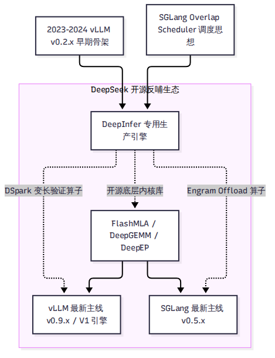
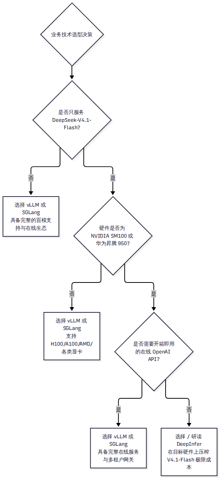

# 第 14 章 与 vLLM、SGLang 的异同

在大模型推理系统领域，vLLM 与 SGLang 无疑是当今全球开源社区最主流的两大通用框架。当 DeepSeek 带着自研的 DeepInfer 杀入开源竞技场并公布惊人的吞吐数字时，技术社区立刻爆发了剧烈的争论：有人称其“彻底终结了通用推理框架”，也有人质疑其“只是换皮与套壳”。

事实究竟如何？面对同一个 DeepSeek-V4.1-Flash 模型，DeepInfer、vLLM 和 SGLang 到底差在哪里？三者有何血统渊源与算子共享？企业与技术团队在落地时又该如何科学抉择？本章将剥离一切非黑即白的立场，从代码血统、架构哲学、技术机制到性能边界展开全维度的深度大横评。

---

## 14.1 架构哲学：专用引擎 vs 通用框架

要读懂三者的异同，首先必须看清它们在设计之初所背负的根本使命差异：**这是“专用特化赛车”与“全地形越野车”的路线抉择。**

### 1. 通用框架的“生态包袱”（vLLM / SGLang）
vLLM 与 SGLang 的定位是**通用型推理服务底座**。
- 它们必须支持成百上千个不同结构的模型（LLaMA、Qwen、Mistral、Gemma、Mixtral 等）。
- 它们必须支持跨厂商、跨代际的丰富硬件生态（NVIDIA 各代显卡、AMD ROCm、Intel Gaudi、各种国产 NPU 甚至纯 CPU）。
- 它们必须提供开箱即用的多租户 OpenAI 兼容 API、动态 LoRA 适配器加载以及复杂的安全审计策略。

为了这份通用性，框架必须建立极其庞大且严密的分层抽象体系（如通用模型注册表、通用的张量并行与流水线抽象、通用的缓存管理器）。这些抽象层在赋予框架极强通用性的同时，也无可避免地在底层带来了微秒级的胶水开销与内存间接寻址成本。

### 2. 专用引擎的“削足适履”（DeepInfer）
DeepInfer 的定位是**单一生产模型的物理性能压榨器**。
- 它从诞生起就只服务 DeepSeek-V4.1-Flash 这一个模型。
- 它坚决放弃对其他任何开源模型的兼容，甚至把 128 滑动窗口、第 20 层 KV 跨层投影、384 专家拓扑与 134 槽位直接硬编码进引擎调度器与算子内部。
- 它彻底剥离了在线 API 服务、动态 LoRA、多种量化方案以及通用的模型注册机制。

这种极端放弃换来的是“零抽象开销”的极致轻盈：CPU 调度没有多余的分支判断，GPU 显存无需动态元数据计算，算子完全针对特定的 Tensor 维度深度融合。

---

## 14.2 血统溯源：剥开 DeepInfer 的 vLLM 外壳

技术社区最关心的问题之一：DeepInfer 和 vLLM 到底是什么关系？它算不算是对 vLLM 的“套壳”或“抄袭”？

### 1. Git 指纹与历史分叉点
根据第三波调研（R15）中对本地源码与 vLLM 历史 13 个 Release Tag 的详细代码指纹比对：
- 在 DeepInfer 的 222 个 Python 文件中，**恰好有 23 个文件的第二行明确注明了 `"Derived from vLLM; modified by DeepSeek."`**（占一阶 Python 总代码量的 12.2%）。
- 通过对这 23 个骨架文件与 vLLM 历史各版本的相似度进行滑动比对发现：**代码相似度在 vLLM `v0.2.7` 版本（2024 年 1 月前后）达到顶峰**，而在此之后，随着 vLLM 逐步向 v0.4、v0.6 以及最新的 V1 引擎演进，两者代码相似度发生断崖式下跌，到最新 main 分支时相似度已不足 2.3%。
- 独立 API 证据（如 `create_engine_configs` 4 元组、`profile_num_available_blocks` 签名）无可辩驳地证明：**DeepInfer 确实分叉（Fork）自 2023 年末至 2024 年初的早期 vLLM v0.2.x 时代。**

### 2. “壳留下、芯全换”的重构事实
然而，如果据此将 DeepInfer 贬低为“简单套壳”，同样严重违背了代码事实。

对 4 个最核心的派生文件做代码逐行对比，展示了 DeepSeek 极其激进的“换芯”手术：
- **`llm_engine.py`（相似度仅 16%）**：原版的纯 Python 调度循环被连根拔除，替换为通过 pybind11 深度绑定的 C++ `csrc/engine/` 调度核心，引入了完整的 ZOS 异步流水线状态机。
- **`cache_engine.py`（相似度仅 9%）**：通用的 PagedAttention 显存管理被全部推翻，替换为服务于 890 字节块状 KV 与 StateBlock 134 槽位的特化显存布局。
- **`worker.py` 与 `model_runner.py`（相似度仅 5% 与 4%）**：通用的前向逻辑被全量重写，换上了基于 Token 档位录制的 CUDA Graph 与 TileLang 镜像双硬件算子。

可以说：DeepInfer 仅仅保留了早期 vLLM 的命令行参数解析、采样参数定义与请求生命周期的**外部接口外壳**，而驱动引擎计算的**调度心脏、显存骨骼与执行算子，已经被彻底自研重构。**

---

## 14.3 全维度技术对比：调度、内存、并行与投机

我们从推理引擎最核心的六大技术维度，对三大引擎的最新实现机制展开横向解构：

| 技术维度 | DeepInfer（Commit 9bd9cf2） | vLLM（Commit 2d40c06, V1 架构） | SGLang（Commit 79eb10e, v0.5.x） | 架构差异成因与技术解读 |
| --- | --- | --- | --- | --- |
| **支持模型与硬件** | 仅支持 V4.1-Flash 单模型；仅支持 NVIDIA SM100 与华为昇腾 950。 | 支持数百款开源模型；广泛支持 NVIDIA、AMD ROCm、Intel、各类 NPU。 | 支持主流开源模型；全面支持 NVIDIA、AMD、昇腾等主流生态。 | 专用极致特化 vs 通用全生态兼容。 |
| **调度机制** | C++ ZOS 零开销异步调度；GPU 就地修正验证长度；无 GIL 开销。 | V1 引擎 `AsyncScheduler`；通过 `-1` 占位 Token 推进流水线重叠。 | 原生 Overlap Scheduler；采用调度/前向/拷贝三流事件驱动与 `FutureMap`。 | 思路同源，但 DeepInfer 与投机解码深度对齐程度最高。 |
| **KV Cache 与前缀复用** | 890 B/token 极限压缩；128 token 硬对齐；外置 3FS 共享池，引擎内无自动 Hash 树。 | PagedAttention 通用分页；基于父哈希+块内容的链式 APC 自动前缀缓存。 | RadixAttention 前缀树（Rust 核心）；三级存储分级体系（HiCache）。 | DeepInfer 依赖云端 3FS 统一解耦，框架强调单机自适应前缀发现。 |
| **分布式并行策略** | 纯 Attention-DP + MoE-EP（Wide-EP 64–128）；坚决不用 TP；支持 Mirror CP。 | 支持 TP、PP、DP-Attention、DEP（双层专家并行）；全面支持各类混合并行。 | 支持 TP、PP、DP-Attention；较早为 DeepSeek 模型开创并优化 DPA。 | 通用框架兼顾单机与小集群，DeepInfer 完全针对超节点定制。 |
| **投机解码实现** | 内置 DFlash 3 层非因果草稿头；DSpark 基于置信度的期望吞吐动态裁剪。 | 支持 EAGLE-1/2、MTP（28种变体）；通过 PR 逐步跟进 Adaptive 变长验证。 | 支持 EAGLE、MTP；针对 V4.1-Flash 提供 DSpark 延迟校正镜像。 | DeepInfer 实现了草稿结构与验证裁决的最短路径闭环。 |
| **正确性与合规保障** | 原生批不变（关闭 split-KV/split-K）；绝对位置 RNG 定序；xgrammar 预编译掩码。 | 支持种子固定；通过 Outlines、xgrammar 等多种后端支持结构化输出。 | 具备确定性采样；采用轻量级自动机支持高吞吐结构化输出。 | DeepInfer 在批不变上做到了浮点逐位全等（Bitwise Exact）。 |

---

## 14.4 性能数字照妖镜：不可比的 6%

2026 年 10 月 21 日，在 DeepInfer 开源后不久，vLLM 官方 X 账号（@vllm_project）发布了一条引爆社区的声明：
> "vLLM decode throughput on GB200 is already within 6% of DeepInfer's published numbers!"
> （vLLM 在 GB200 上的解码吞吐量，已经达到了 DeepInfer 公布数字的 6% 以内！）

这个声明引发了大量技术讨论：“既然差距只有 6%，那 DeepInfer 还有什么意义？”

### 七条不可比的物理边界
严肃的技术分析绝不能脱离测试前置条件。深入查证第三波调研（R13 与 R16）的证据链后，我们必须揭开这“6%”背后的真实物理边界：

1. **硬件与拓扑未对齐**：vLLM 的声明只写了“on GB200”，但**完全没有公布使用了多少张 GPU、采用什么网络互联拓扑、使用的是 TP 还是 EP**。而 DeepInfer 公布的 Decode Pareto 曲线明确标注基于 **64 张 SM100、EP64/DP64（TP1）、131,072 上下文** 的超节点环境。
2. **基线数字包含推导假设**：DeepInfer README 中的 Pareto 曲线并不是裸的每秒步频，而是乘以了系数 $ au = 1 +   \text{nextn}   \times \alpha$（设定接受率 $\alpha=75\%$ 对应 $ au=3.25$）。vLLM 在对比时是否采用了相同的投机倍率，官方推文并未说明。
3. **第三方实测的方向性逆转**：在脱离了 64 卡超节点的其他第三方实测中，由于硬件环境变化，结果呈现出截然不同的面貌：
   - 在 GPUStack 进行的单机 8×B200 测试中，DeepInfer 吞吐比 vLLM 高出约 25.2%，但首字延迟（TTFT）却比 vLLM 慢了一倍以上（2.09×）。
   - 在开源工具 warmctl 进行的单节点 8×B300 测试中，vLLM 的解码吞吐反倒比 DeepInfer 快了 1.8 到 4.3 倍，Prefill 甚至快了 8 到 9 倍！

**结论非常明确：没有任何一个引擎能够在所有硬件、所有并发和所有拓扑下通赢。** 
脱离了卡数规模（单机 8 卡 vs 64 卡超节点）、脱离了前缀命中率（零缓存 vs 3FS 高命中）、脱离了并发工作点谈论“谁比谁快百分之几”，在系统工程上是毫无意义的。

---

## 14.5 生态反哺与选型决策指南

大模型开源社区并不是非此即彼的零和博弈，而是一场精彩的“技术反哺与双向奔赴”：

### 底层算子的全面共享
仔细观察三大框架的技术栈，你会发现一个有趣的现象：**DeepSeek 实际上成为了当今主流推理框架的共同底座。**
- vLLM 深度集成了 DeepSeek 开源的 `FlashMLA`、`DeepGEMM` 和 `DeepEP`。
- SGLang 同样将这些算子作为其高性能后端的核心组件。
- 在 DeepInfer 开源不到 48 小时内，vLLM 社区就提交了 RFC #62839 与 PR #62840，直接引用 DeepInfer 的代码行数，吸纳其 DSpark 置信度头 TileLang 算子。

### 技术选型决策树
对于面临真实业务落地的技术决策者与工程师，我们梳理了以下清晰的决策逻辑：

1. **多模型、混合硬件、多租户在线商用服务 → 坚决选择 vLLM 或 SGLang**：
   如果你需要对外提供标准的 OpenAI/REST API，需要支持 LLaMA、Qwen 等多个不同模型，手头拥有的是 H100/A100 或常规集群，vLLM 与 SGLang 拥有完善的在线服务生态与活跃的全球社区支持，是毫无疑问的首选。
2. **顶配超节点硬件、极大规模并发、深度研读先进设计 → 选择与研读 DeepInfer**：
   如果你的目标就是在 64–128 张英伟达 SM100 或华为昇腾 950 构成的超大集群上，以最低的边际成本压榨 DeepSeek-V4.1-Flash 的极限吞吐；或者你是一位推理系统研发专家，希望从其激进的 SWA 有界重放、C++ 异步调度与 FP4 显存管理中汲取养分、反哺自己的自研系统，那么 DeepInfer 是一座无可替代的技术金矿。

---

## 小结

- DeepInfer 与 vLLM/SGLang 的根本差异在于定位：专为一模型一架构削足适履的专用赛车 vs 兼顾全生态的通用越野车。
- DeepInfer 骨架源自早期 vLLM v0.2.x，但经历了彻底的“换芯”重构；三大框架在底层深度共享着 FlashMLA、DeepGEMM 等核心内核。
- 所谓的“性能差距 6%”带有极强的前置约束条件，在不同硬件拓扑下各具优劣，技术选型必须严格从业务模型与硬件实际出发。

站在这个高度审视完所有技术细节之后，我们需要对整个系统进行一次冷静的哲学复盘。下一章，我们将探讨 DeepInfer 的长处与局限，以及它所折射出的大模型推理行业未来趋势。
