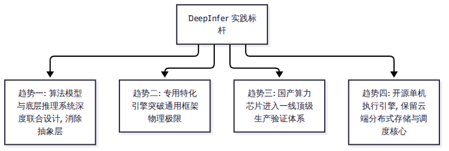

# 第 15 章 评价与思考

当技术褪去初期的神秘光环，一个工程系统的真正历史价值便清晰地浮现出来。

DeepInfer 的开源是大模型系统演进史上一个极具象征意义的事件。它不仅向外界展示了一家顶级 AI 原生企业如何用软硬件协同工程将推理成本压低至常人难以想象的区间，同时也极其坦率地暴露了工业界自用特化系统走向开源时所固有的天然局限。本章将对 DeepInfer 展开客观的综合评价，总结其开创性的工程长处，正视其高墙之内的客观短板，并对大模型推理系统的未来演进趋势提出我们的研判。

---

## 15.1 开创性的长处：软硬协同的极致标杆

如果将 DeepInfer 放在整个计算系统发展史的坐标系中审视，它的最大贡献在于：**它以极其激进的姿态，打破了长期以来模型算法团队与底层系统工程团队之间的“无形隔离墙”。**

1. **算法与系统的全链路联合设计**：在过去的通用框架中，系统工程师往往被动接收算法团队丢过来的模型结构，并试图在已有通用算子库上打补丁。而在 DeepInfer 中，我们看到了前所未有的双向奔赴——算法团队设计了 SWA 局部窗口与 YOCO 第 20 层投影，系统团队便立刻借此做出了砍掉 98.6% Decoder Prefill 算力的有界重放；算法团队设计了 DFlash 草稿与置信度头，系统团队便立刻用 TileLang 算子在 GPU 端做出了动态边际收益变长截断。这种深度定制带来的性能收益，是任何通用分层抽象框架所无法企及的。
2. **国产算力芯片的标杆级一线落地**：长期以来，国产加速卡在开源社区的地位往往停留在“兼容适配、跑通 Demo”的初级阶段。DeepInfer 证明了华为昇腾 950 能够与英伟达 Blackwell 处于完全平等的地位，直接作为核心动力驱动日服务超百万亿 token 的顶级工业生产系统。代码中针对昇腾向量指令与片上 Unified Buffer 的深度手写调优，为国产算力进入顶级生产验证树立了极具说服力的行业标杆。
3. **透明详实的工程技术披露**：从 `doc/inference_deployment_qa.md` 的数十个问答到知乎专栏的长文复盘，DeepSeek 极其坦白地公开了其内部关于 P/D 分离比例、3FS 存储容量、GDR 时延微秒级对比、EPLB 负载不均衡度以及 FlashMLA 相比内部版缺少 SASS 调优等一系列关键工程细节。这种毫不遮掩、实事求是的工程师文化，对整个技术社区反思推理系统设计带来了深远启发。

---

## 15.2 客观存在的局限：高墙之内的特种武器

然而，正如我们在全书反复强调的，赞赏不能掩盖短板。对于绝大多数中小型技术团队和普通开发者而言，当前的 DeepInfer 是一把被锁在高墙之内的“特种武器”：

1. **极其苛刻的物理准入门槛**：代码中写死了对英伟达 SM100（Blackwell）与华为昇腾 950 的硬件门禁，且生产高效部署要求 64P+64D 的庞大超节点单元。对于广大手头仅有 A100、H100 或消费级显卡的团队而言，根本无法将其直接引入现有的生产集群中替代现有方案。
2. **离线单机与云端在线的严重断层**：开源代码剥离了所有的在线服务基础设施（无多租户管理、无 OpenAI 协议端口、无 3FS 分布式存储驱动、无跨机 Prefill 算力配额调度）。任何试图将其商用化的团队，都必须自行投入巨大的研发力量补齐这“没有开源的那一半”。
3. **绝对封闭的单模型锁定**：引擎的代码逻辑与 V4.1-Flash 的数学结构深度耦合。它不仅无法运行任何其他开源模型，甚至如果未来 DeepSeek 自身的 V5 模型在层数、窗口或压缩比上稍作调整，整个引擎的许多核心算子和显存槽位都必须推倒重来。代码的可复用性极其低下。
4. **代码注释与工程治理规范**：通过代码审查发现，仓库中超过 22% 的 Python 注释和近 69% 的 C++ 行首注释直接采用了中文（且存在部分开发过程中的过时注释与 `import pytest` 等未清理的遗留项）。这在一定程度上阻碍了全球国际开源开发者的深度理解与协同贡献（正如 GitHub 上几乎所有提交的 PR 都在忙于修补依赖与硬件报错）。

---

## 15.3 行业启示：推理系统的未来演进方向

结合 DeepInfer 的实践与主流通用框架的最新动态，我们可以对未来大模型推理系统的技术演进提出四点趋势推断（标为 E 级分析）：

1. **专用引擎与通用框架走向“双轨融合”**：纯粹的通用框架正在变得越来越笨重，而纯粹的专用引擎又过于狭窄。未来的趋势是通用框架（如 vLLM 和 SGLang）在顶层维持丰富的百模接口与在线服务生态，而在底层逐步为超头部核心模型（如 DeepSeek 系列、LLaMA 系列）开辟专属的“零抽象旁路加速通道”（正如 vLLM 正在合入的 DSpark 算子与 SGLang 的专有镜像）。
2. **“开源执行引擎，保留云端基础设施”将成为新型开源范式**：出于技术保密与商业壁垒的考虑，未来的 AI 基础设施巨头将越来越倾向于开放单机层面的计算与算子代码（以赢得全球技术口碑与标准定义权），而将其赖以生存的分布式大规模弹性调度、多级存储集群与软硬通信编排作为云服务的商业护城河保留在幕后。
3. **软硬一体化端到端协同将成为核心竞争力**：随着半导体工艺逐渐逼近物理极限，单纯依靠堆叠硬件晶体管获得算力翻倍的时代正在终结。未来顶级大模型的竞争，将是算法数学家、系统架构师与底层芯片微码工程师三位一体的协同竞争。谁能在模型设计的第一天就把显存带宽、网络拓扑与算子流水考虑进去，谁就能在 token 边际服务成本上确立降维打击式的代际优势。

---

## 小结

- DeepInfer 是算法数学与底层硬件微架构深度协同的工程奇迹，展现了单模型极端特化所能达到的成本压榨极限，并树立了国产算力一线落地的典范。
- 它的局限同样清晰：硬件门槛极高、不支持在线服务、代码绝对单模型锁定，属于典型的工业自用栈剥离产物。
- 它宣告了大模型系统工程走向“算法-系统端到端联合设计”的全新时代，并深刻重塑了开源社区的技术演进逻辑。

看清了这套系统的过去与未来，面对这样一个庞大而特化的系统，没有 64 张高端 GPU 的我们该如何真正动手研读它？下一章，我们将为读者量身定制一份科学的上手学习与实验指南。
