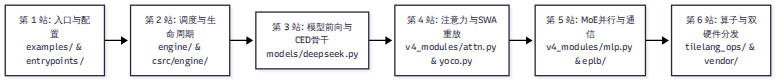

# 第 16 章 如何上手学习

::: warning
客观声明：本书作者基于公开的官方技术文档、锁定 Commit（`9bd9cf2`）的完整源码、权重元数据及测试脚本进行了静态研读与部分 CPU 模块验证，未在 64 张英伟达 SM100 或华为昇腾 950 物理集群上进行全流程实机运行。本章的实验设计旨在为没有高端集群的普通开发者提供一条切实可行的低门槛学习路径。
:::

读完前十五章的读者往往会面临一个非常现实的尴尬：DeepInfer 的架构设计极其精妙，但它要求的运行环境（64 张 Blackwell 或昇腾 950）对 99.9% 的工程师和在校学生来说都是遥不可及的天文数字。

没有物理硬件，是不是就只能望洋兴叹？绝对不是。软件工程中最宝贵的往往是架构思维、数据流编排以及代码级的实现技巧。本章将为读者设计一套科学的“无卡研读与动手实验指南”，帮助你在普通笔记本或 CPU 服务器上，真正把这套系统的精髓吸收内化。

---

## 16.1 物理门槛：生产与学习的客观鸿沟

在尝试克隆代码前，首先必须破除对运行硬件的侥幸心理：

1. **单机最低运行门槛**：根据 `examples/offline_inference.py` 的默认配置（`--ep 8`），系统的理论最小运行单元是**单台配备 8 张全互联顶级计算卡（SM100 或 昇腾 950）的物理服务器**。低于 8 卡，专家并行（EP）的通信逻辑将无法完整闭环。
2. **生产高效部署单元**：根据官方 Q&A 披露，真正能够打出官方 Pareto 曲线的生产单元是 **64 台 Prefill 节点（EP2–8）配合 64 台 Decode 超节点（EP64–128）**。单卡显存容量（HBM）必须在容纳静态权重切片的同时，留足至少 20–30 GB 供动态 KV Cache 与 CUDA Graph 显存池使用。
3. **硬件门禁强行报错**：再次提醒，由于 `deepinfer/engine/llm_engine.py` 在初始化时内置了对显卡 TFLOPS 算力档位的硬性断言，在 Hopper（H100/H800）或 Ampere（A100/4090）等常见显卡上执行主程序，会直接抛出 `RuntimeError: unknown GPU type` 异常。

因此，**不要试图在不符合条件的普通显卡上去“跑通”它**。把精力聚焦在代码研读与模块隔离验证上，才是最明智的学习策略。

---

## 16.2 推荐阅读路线：六站读码之旅

面对近 6 万行代码，我们为读者梳理了一条由表及里、循序渐进的“六站式”代码阅读主线：



### 第 1 站：入口与配置（耗时约 1 小时）
- **核心文件**：`examples/offline_inference.py` → `deepinfer/entrypoints/llm.py` → `deepinfer/config.py` 与 `environ.py`。
- **阅读目标**：看懂引擎如何解析命令行参数，如何根据环境变量动态初始化全局配置，弄清 `EngineArgs` 与 `SamplingParams` 的结构。

### 第 2 站：调度与生命周期（耗时约 3 小时）
- **核心文件**：`deepinfer/engine/llm_engine.py` → `deepinfer/worker/worker.py` → `csrc/engine/scheduler.hpp` 与 `zos.cpp`。
- **阅读目标**：精读第 6 章讲到的 ZOS 异步调度循环，观察 CPU 如何在 C++ 层面推进状态机，重点理解 `MetadataZOS` 与 `remap` 映射表在 Python 与 C++ 之间的流转。

### 第 3 站：模型前向与 CED 骨干（耗时约 2 小时）
- **核心文件**：`deepinfer/model_executor/models/deepseek.py` → `decoder_layer.py` → `hugging_face/config.py`。
- **阅读目标**：观察同一个 `DeepseekDecoderLayer` 如何跑过 40 层，确认第 20 层切分点是如何从 `compress_ratios` 推导出来的。

### 第 4 站：注意力与 SWA 有界重放（耗时约 4 小时）
- **核心文件**：`deepinfer/model_executor/models/v4_modules/attn.py` → `yoco.py` → `csrc/engine/prepare_tensor_input_v4.cpp`。
- **阅读目标**：精读第 8 章推导的有界重放公式在代码中的落地，观察 4 个整数 pivots 如何被展开为注意力索引矩阵。

### 第 5 站：MoE 并行与动态通信（耗时约 3 小时）
- **核心文件**：`deepinfer/model_executor/models/v4_modules/mlp.py` → `eplb/policy.py` → `parallel_utils/parallel_state.py`。
- **阅读目标**：阅读 Token 经过门控网络后被打包送入 DeepEP 的数据流，研读 EPLB 的两级贪心装箱算法。

### 第 6 站：底层内核与双硬件分发（耗时约 2 小时）
- **核心文件**：`deepinfer/model_executor/layers/tilelang_ops/ops.py` → 对照阅读 `cuda/` 与 `asc/` 下的同名算子。
- **阅读目标**：体会 TileLang 是如何用统一的高级 Python 语法，同时面向英伟达 TMA 与昇腾 Unified Buffer 输出镜像代码的。

---

## 16.3 无卡环境下的动手实验设计

没有高端显卡，依然有多种方法可以在普通机器上亲自动手实践：

### 实验一：纯 CPU 环境下的模块静态导入与配置解析
DeepInfer 的很多基础配置模块并不强依赖 GPU 驱动。在纯 CPU 的 Python 3.10+ 环境下，你可以直接执行：

```bash
# 进入仓库目录，直接测试环境变量加载与类型转换
python3 -c "
from deepinfer.environ import envs
print('DeepInfer 版本与配置加载成功:')
print('  MTP_VARLEN 默认开关:', envs.DEEPINFER_ENABLE_MTP_VARLEN)
print('  KEEP_TOKENS 默认值:', envs.DEEPINFER_YOCO_PREFILL_KEEP_TOKENS)
"
```
通过阅读 `environ.py` 中的 `_bool`、`_int` 解析逻辑，你可以学习工业级系统如何通过环境变量安全覆盖配置。

### 实验二：精读并运行 `yoco_equiv.py` 逻辑单元
在 `examples/yoco/yoco_equiv.py` 中，虽然完整的 L2 测试需要多卡并行，但 L1 层的“紧凑张量与全量 Mask 数学等价性校验”在逻辑上是纯数学的。你可以抽取出其中的矩阵展开算法，在本地用 NumPy 复现并验证不同滑动窗口大小下的可见域是否严丝合缝。

### 实验三：23 个派生文件与 vLLM 的跨代代码 Diff
这是最能提升系统架构功力的硬核练习：
1. 下载 vLLM v0.2.7 源码与当前最新的 vLLM V1 源码。
2. 挑选 `cache_engine.py`、`llm_engine.py` 或 `sampler.py`。
3. 使用 `diff` 或 VS Code 的对比窗口，逐行观察 DeepSeek 是如何把通用的代码一步步删减、硬编码、并替换为自研 C++/TileLang 算子的。这种对比能让你最直观地感受到“从通用到专用”的工程取舍。

---

## 16.4 Profile 实战：如何从 Trace 中看懂底层调用

如果你有幸在支持的测试机上接触到真机环境，或者拿到了他人分享的 PyTorch Profiler 跟踪文件（Trace JSON）：

### 1. 启动 Benchmark 与性能分析
官方提供了基准压测脚本 `examples/benchmark.py`。需要特别注意的是：
- 在代码中，环境变量 `PROFILE` 默认是开启的（`PROFILE=1`）。
- **避坑提示**：Profiler 本身会引入微秒级的追踪开销，导致测量出的单步耗时虚高近 50%。正式测量纯吞吐时，必须显式设置 `PROFILE=0`；只有在诊断算子内部构成时，才开启 `PROFILE=1`。

### 2. 在 Chrome 浏览器中剖析 Trace
将生成的 Trace 文件下载到本地，在 Chrome 浏览器中输入 `chrome://tracing` 或打开 `ui.perfetto.dev` 并加载文件，你可以清晰看到 GPU 上的时间线切片：
- **FlashMLA Decode 内核**：呈现为紧凑的蓝色矩形，耗时通常占整个注意力步的绝大部分。
- **DeepEP All-to-All 通信**：呈现为位于 MoE 前后的集合通信条，观察它是否与随后的 GEMM 计算实现了良好的时间重叠。
- **Mega MoE 融合块**：如果在单机 Scale-Up 域内，你将看到独立的通信与计算块消失了，取而代之的是单个连续打满 SM 的大内核。

---

## 小结

- 硬件门槛客观存在，不要盲目在不受支持的普通卡上尝试强行跑通，应将重心放在架构研读上。
- 遵循“入口 → 调度 → 模型 → 注意力与 SWA → 并行通信 → 算子”的六站式阅读路线，能帮助你最高效地穿透近 6 万行代码。
- 在无卡环境下，通过纯 CPU 配置加载、数学等价性验证、以及与 vLLM 历史代码的详细 Diff 对比，同样能够获得深度的系统架构认知。

全书的技术旅程即将抵达终点。在最后一章中，我们将全书凝聚为 20 个最高频、最尖锐的核心技术问题，为你做最后的系统答疑。
